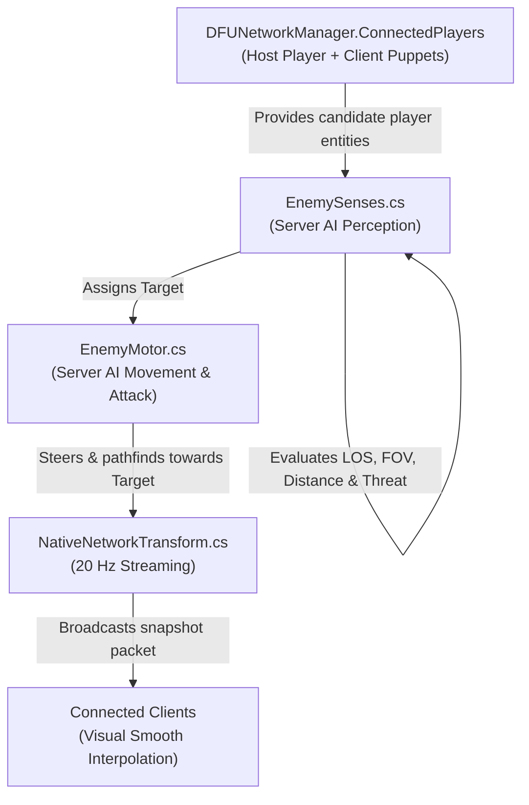
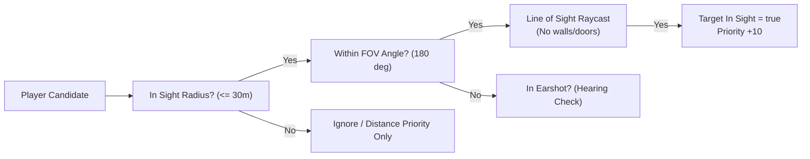

# Multi-Target Server AI & Targeting System (Phase 4)

## 1. Overview & Objective

In single-player Daggerfall Unity (DFU), all enemy sensory detection, hearing, line-of-sight raycasts, and pursuit pathfinding are hardcoded directly to the singleton player (`GameManager.Instance.PlayerEntityBehaviour`).

In multiplayer, authoritative enemies run exclusively on the **Host / Server**. The server must perceive and dynamically engage **any connected player** (the local Host player as well as all connected Client remote avatars) based on proximity, line of sight, and threat.

---

## 2. Core Architecture & Components

### Components Involved:
1. **`DFUNetworkManager.ConnectedPlayers`**:
   - Server-side registry tracking all active player entities (`DaggerfallEntityBehaviour`) present in the world.
   - Host player is registered upon session start.
   - Remote client puppets (`NativePlayerPuppet`) register upon instantiation and unregister upon disconnect.
2. **`NativePlayerPuppet`**:
   - Equipped with a `CapsuleCollider` and a recognized player entity context so physics raycasts in `EnemySenses.CanSeeTarget()` physically hit the avatar.
3. **`EnemySenses.cs`**:
   - Replaced single-player references (`player = GameManager.Instance.PlayerEntityBehaviour`) with multi-player sweeps across `ConnectedPlayers`.
   - Computes target priority and handles target switching with hysteresis.
4. **`EnemyMotor.cs`**:
   - Steers towards `senses.Target.transform.position`, regardless of whether the target is the Host or a remote Client.

---

## 3. Perception & Sensory Pipeline

Enemies evaluate targets at fixed intervals (`classicTargetUpdateTimer` ~5s in classic or every decision tick):

1. **Field of View (FOV):**
   - Standard 180° frontal cone (or 190° if `EnhancedCombatAI` is enabled).
2. **Line of Sight (LOS Raycast):**
   - A physical raycast is fired from the enemy's eye position to the player's eye position (`transform.position + Vector3.up * eyeHeight`).
   - Blocked by static geometry (dungeon walls, floors, ceilings) and closed action doors.
   - Hits the player's collider (`DaggerfallEntityBehaviour`).
3. **Hearing & Alert:**
   - If a player is running or attacking within `HearingRadius`, enemy can become alerted even outside the frontal FOV.

---

## 4. Priority Scoring Algorithm

Each potential player candidate receives a priority score computed as follows:

$$\text{Priority} = \text{ThreatBonus} + \text{VisibilityBonus} + \text{ProximityBonus}$$

Where:
* **Visibility Bonus:**
  * Visible (`CanSeeTarget` is true): **+10 points**
  * Not visible (behind wall/obstacle): **0 points**
* **Proximity Bonus (Clamped to max range 30m):**
  $$\text{ProximityBonus} = \max(0, 30 - \text{distanceToTarget})$$
  *(e.g., A player at 5 meters receives +25 points; a player at 20 meters receives +10 points)*
* **Unengaged Target Bonus:**
  * If the target is not currently being targeted by another enemy: **+5 points** (prevents entire rooms from dogpiling on one player while ignoring others).
* **Threat / Aggro Bonus (Phase 5 hook):**
  * When a player deals damage to this enemy, they receive an immediate **+20 threat bonus**.

---

## 5. Anti-Flapping & Hysteresis

To prevent jittery or erratic target switching when two players are standing near each other at similar distances:

1. **Switching Threshold ($\Delta = 3$ points):**
   - A new candidate must exceed the current target's priority by at least **3.0 points** (equivalent to being ~3 meters closer) to trigger a target switch.
2. **Lost Target Grace Period:**
   - If the current target runs behind a wall or door, the enemy pursues the `LastKnownTargetPos` for up to 5 seconds before switching to the next highest priority visible player.

---

## 6. Single-Player & Offline Compatibility

If `NetworkSession.IsActive` is false (Single Player mode):
* `ConnectedPlayers` contains only `GameManager.Instance.PlayerEntityBehaviour`.
* Targeting logic degrades 1:1 to standard native DFU single-player behavior without breaking quests, stealth mechanics, or classic savegames.
