# Product Requirements Document (PRD): Native Server-Authoritative Multiplayer for Daggerfall Unity

**Document Version:** 1.0.0  
**Target Architecture:** Native Server-Authoritative / Client-Proxy  
**Base Engine:** Daggerfall Unity (C# / Unity)  
**Target Path:** Core integration (`Assets/Scripts/Game/Networking/` & `Assets/Scripts/`) replacing mod hooks (`Assets/Game/Mods/TanguyMultiplayer/`)

---

## 1. Executive Summary & Vision

### 1.1 The Objective
Transform Daggerfall Unity (DFU) from a single-player game modified by post-spawn interception hooks (the legacy `TanguyMultiplayer` mod architecture) into a **natively networked, server-authoritative cooperative RPG**.

### 1.2 Core Architectural Principle: No More Catchers
In the legacy mod approach:
- Every client ran the vanilla single-player spawning logic independently.
- External "Catcher" scripts continuously polled the scene using `FindObjectsOfType`, attempted fuzzy distance heuristics (< 5m) to guess which monster was which, and retroactively disabled AI and physics on clients.
- This resulted in inevitable race conditions, phantom entities, duplicate spawns, and desynchronization.

In the **Native Multiplayer Architecture**:
- **Single Source of Truth (Server/Host):** Only the server executes procedural world generation spawners, rolls random tables, spawns entities, runs AI behaviour trees (`EnemyMotor`, `EnemySenses`, `EnemyAttack`), and resolves combat math (`FormulaHelper`).
- **Passive Replicated Clients:** Pure clients **never** run autonomous dungeon or world enemy spawners. They receive explicit network spawn messages from the server, instantiate passive presentation puppets (visual billboard, animations, audio), and interpolate motion driven by server tick snapshots.

```mermaid
flowchart TD
    subgraph Server_Host ["Server / Host (Authoritative Engine)"]
        S_Spawn["Dungeon / World Spawner (RDBLayout / Quests)"] -->|Authoritative Spawn| S_Entity["Authoritative NetworkEnemy (AI, Senses, Motor, Health)"]
        S_AI["Multi-Player AI Loop (Targets Player 1..N)"] --> S_Entity
        S_Entity -->|Replication Stream (15-20 Hz)| Net_Bus["Network Transport (Mirror / NAL)"]
        S_Combat["FormulaHelper / Hit Resolution"] --> S_Entity
    end

    subgraph Client_1 ["Client 1 (Passive Proxy)"]
        Net_Bus -->|Spawn Message (GUID, Type, Pos)| C1_Proxy["Client Puppet (Billboard, Audio)"]
        Net_Bus -->|Position & State Stream| C1_Lerp["NativeNetworkTransform (Interpolation)"]
        C1_Lerp --> C1_Proxy
        C1_Input["Player Attack Action"] -->|CmdAttack(GUID, Params)| Net_Bus
    end
```

---

## 2. Gap Analysis: Mod-Based vs. Native Engine Integration

| Aspect | Legacy Mod Architecture (`TanguyMultiplayer`) | Target Native Engine Architecture (`DFU Core`) |
| :--- | :--- | :--- |
| **Spawning Authority** | Every client instantiates entities locally via vanilla spawner code; `EntityCatcher` tries to match them post-facto. | **Server Only.** Spawners check `NetworkServer.active`. Clients completely bypass local instantiation routines. |
| **Entity Identity** | Guessed at runtime by comparing spatial proximity (`Vector3.Distance < 5m`). | Deterministic Network Instance ID (`NetworkIdentity` / `Guid`) assigned at spawn time on server. |
| **Client AI Execution** | `EnemyMotor` starts executing on client, then is retroactively disabled if caught. | `EnemyMotor`, `EnemySenses`, and `EnemyAttack` are **never attached or enabled** on remote client puppets. |
| **Polling & Overhead** | Heavy runtime scanning via `GameObject.FindObjectsOfType` in coroutines and update loops. | **Zero discovery scans.** Direct event-driven registration in `DFUNetworkRegistry` indexed by Network ID. |
| **Assembly Structure** | Mod code isolated in `Assets/Game/Mods/`, forcing hacky reflection or public monkey-patching. | Integrated into `Assets/Scripts/Game/Networking/` and core game scripts with clear `.asmdef` boundaries. |

---

## 3. Core Engine Challenges & Architectural Solutions

### 3.1 Challenge 1: The 500 km World & Floating Origin (IEEE 754 Hardware Limit)
* **The Root Cause:** Daggerfall's world spans nearly 500 km x 250 km. Unity's 32-bit `float` transforms, PhysX colliders, and GPU vertex shaders possess only 24 bits of mantissa (~7 significant decimal digits). Beyond several kilometers from `(0,0,0)`, precision degrades to multiple centimeters, causing severe mesh vertex vibration (*jitter*), collision clipping, and raycast misses.
* **The Single-Player Mechanism:** `FloatingOrigin.cs` regularly offsets the entire Unity scene hierarchy backwards by `-offset` when the local player crosses map boundaries, maintaining the player near `(0,0,0)`.
* **The Multi-Observer Problem:** If each client or server offsets its scene origin independently, raw Unity `Vector3` coordinates diverge completely across connected peers.
* **The Architectural Solution (Compound Global Coordinates & Client-Local Rebasing):**
  1. **Server Simulates Globally:** The server does not render graphics and is immune to 32-bit GPU jitter. It tracks all world entities using **Compound Coordinates**: `(DFPosition MapPixel, Vector3 LocalOffset)` or 64-bit `Vector3d` precision.
  2. **Clients Maintain Independent Local Origins:** Each client runs its own `FloatingOrigin` centered on its own local camera.
  3. **Client-Local Origin Rebasing:** When the server broadcasts an entity's position, the client calculates its local scene coordinate via:
     $$\mathbf{P}_{\text{ClientScene}} = \mathbf{P}_{\text{GlobalEntity}} - \mathbf{P}_{\text{ClientLocalOrigin}}$$
  4. **Interest Management / Culling:** Entities further than active rendering distance (e.g., > 1.5 km) are never instantiated or simulated on that client. Inside dungeons, coordinates are local to the dungeon root, avoiding floating origin shifts altogether.

### 3.2 Challenge 2: Spawner & RNG Divergence (`RDBLayout.cs`)
* **The Root Cause:** While dungeon block architecture (`RDBLayout`) and world terrain are 100% deterministic (loaded from classic `.BSA` files), enemy spawns depend on runtime PRNG (`DFRandom.srand`, `UnityEngine.Random.InitState`) and local player settings (e.g., `DaggerfallUnity.Settings.AlternateRandomEnemySelection`).
* **The Conflict:** If clients independently execute `AddRandomEnemies` or `AddFixedEnemies`, client and host generate different enemy types, quantities, or stats at the same spawn markers.
* **The Architectural Solution (Server-Authoritative Dynamic Spawns):**
  1. **Deterministic Static Geometry:** Clients locally construct dungeon meshes, doors, and static lights from `.BSA` data.
  2. **Gated Entity Spawning:** In `RDBLayout.cs` and `GameObjectHelper.cs`, `AddFixedEnemies` and `AddRandomEnemies` check `NetworkSession.IsServer`. If running on a pure client, execution **returns immediately without instantiating any GameObjects**.
  3. **Explicit Network Spawn Packets:** The server alone rolls encounter tables and broadcasts explicit `MsgSpawnEnemy` packets containing `entityId` (GUID), `mobileType`, `reaction`, and initial transform. All clients instantiate exact visual replicas without local RNG evaluation.

### 3.3 Challenge 3: Cell Lifecycle & World Transitions (`StreamingWorld` vs `PlayerEnterExit`)
* **The Root Cause:** In single-player DFU, `PlayerEnterExit.cs` enforces a single active cell context. Entering a dungeon executes `DisableAllParents(false)`, completely disabling exterior terrain streaming (`ExteriorParent`) and enabling `DungeonParent`.
* **The Conflict:** If Player A enters a dungeon while Player B remains in the wilderness, single-player DFU cannot stream terrain for Player B while simultaneously maintaining the interior dungeon hierarchy for Player A without state collision.
* **The Architectural Solutions (Two-Tier Approach):**
  * **Tier 1 (Party-Synchronized Co-op - Milestone Target):**
    - Transitioning through dungeon doors prompts all connected players to enter together (classic co-op party transition).
    - Guarantees all players share the same active cell instance, eliminating complex multi-zone streaming changes in early phases.
  * **Tier 2 (Multi-Zone Spatial Filtering - Long-Term MMO Target):**
    - Decouple `ExteriorParent` and `DungeonParent` visibility to be purely client-side local cameras.
    - Server maintains an `ActiveZoneRegistry` (`ZoneType.Exterior`, `ZoneType.Dungeon_LocationID`).
    - Network transport uses **Spatial Zone Filtering**: packets originating from a dungeon cell are only sent to players currently registered in that dungeon's zone ID.

---

## 4. Phased Implementation Roadmap

Each phase produces a **discrete, testable milestone** with explicit manual testing protocols using two Unity instances (Host + Client).

```mermaid
flowchart LR
    P1["Phase 1: Core Networking & Session Lifecycle"] --> P2["Phase 2: Authoritative Spawner Pipeline"]
    P2 --> P3["Phase 3: Client Puppet & Motion Interpolation"]
    P3 --> P4["Phase 4: Multi-Target Server AI"]
    P4 --> P5["Phase 5: Authoritative Combat & Health"]
    P5 --> P6["Phase 6: Synchronized World State & Loot"]
    P6 --> P7["Phase 7: Remote Players & Cell Sync"]
    P7 --> P8["Phase 8: World Time, Sky & Weather Sync"]
    P8 --> P9["Phase 9: Fast Travel & Party Voting"]
    P9 --> P10["Phase 10: Shared Quests, Dialogue & Geolocation"]
    P10 --> P11["Phase 11: Spells & Player Interactions"]
    P11 --> P12["Phase 12: Legacy Purge & Standalone Release"]
```



---

### Phase 1: Core Networking Foundation & Session Lifecycle

**Goal:** Establish clean, native networking infrastructure directly in DFU core without dependency on mod loaders.

#### Tasks:
- [x] **1.1 Assembly & Library Relocation:** Relocated Mirror to `Assets/Mirror/` out of legacy mod folder; core scripts reside in `Assets/Scripts/Game/Networking/`.
- [x] **1.2 Native Network Manager:** Promoted `DFUNetworkManager` to first-class engine subsystem registered in `GameManager.Instance.NetworkManager`.
- [x] **1.3 Session Role Provider:** Created `NetworkSession` utility exposing `IsServer`, `IsClient`, `IsHost`, `IsSinglePlayer`, `ShouldHandleSpawns`.
- [x] **1.4 Connect UI / CLI Hook:** Provided `net_host`, `net_join`, `net_disconnect`, `net_status`, and `net_gui` console commands via `DFUNetworkCommands`.

#### Verifiable Milestone 1:
- Starting the game allows hosting a server or connecting as a pure client.
- `NetworkSession.IsServer` and `NetworkSession.IsClient` correctly resolve across both instances.
- Zero errors in Unity console during connection handshake.

#### Manual Test Procedure 1:
1. Open Instance A (Host) in Unity Editor and start Host.
2. Build and run Instance B (Client), entering `localhost`.
3. Verify connection in Unity Editor console: `[DFU Network] Client connected from 127.0.0.1`.
4. Close Client; verify Host logs clean disconnection without memory leaks.

---

### Phase 2: Authoritative Spawner Pipeline (The Death of Catchers)

**Goal:** Prevent pure clients from spawning single-player monsters, and ensure the server alone instantiates enemies and broadcasts spawn instructions.

#### Tasks:
- [x] **2.1 Dungeon Spawner Interception:** Modify `RDBLayout.cs` (`AddFixedEnemies`, `AddRandomEnemies`) to check `NetworkSession.ShouldHandleSpawns`:
  - If Server/Host or SinglePlayer: execute normal spawn logic.
  - If Pure Client (`!NetworkSession.ShouldHandleSpawns`): **skip spawning completely**.
- [x] **2.2 Quest & Wandering Encounter Interception:** Gate `GameObjectHelper.CreateEnemy`, `CreateFoeGameObjects`, `CreateFoeSpawner`, and `FoeSpawner.Update` behind `NetworkSession.ShouldHandleSpawns`.
- [x] **2.3 Network Enemy Prefab / Definition:** Created standardized network spawn packet `MsgSpawnEnemy` and `MsgDespawnEnemy` in `NativeNetworkMessages.cs`.
- [x] **2.4 Authoritative Spawn Broadcaster:** Server attaches `NativeNetworkEntity` upon `GameManager.OnEnemySpawn`, registers in `DFUNetworkRegistry`, broadcasts `MsgSpawnEnemy` to connected clients, and synchronizes existing entities on client connect.
- [x] **2.5 Client Spawn Receiver:** Client receives `MsgSpawnEnemy`, checks `DFUNetworkRegistry`, instantiates proxy puppet via `GameObjectHelper.CreateClientEnemyProxy`, disables local AI/physics, and registers with assigned `entityId`. Client removes and destroys proxies on `MsgDespawnEnemy` or session disconnect.

#### Verifiable Milestone 2:
- Host enters a dungeon cell: enemies spawn on the Host.
- Client enters the same cell: **zero local enemies spawn independently**. The client scene remains completely empty until receiving server spawn packets.
- Total enemy count on Host exactly matches total proxy count on Client (1:1 correspondence, zero duplicates).

#### Manual Test Procedure 2:
1. Start Host in a dungeon scene with known spawners (e.g., Privateer's Hold).
2. Connect Client.
3. Pause Unity Editor on Client and inspect hierarchy:
   - Verify that no `DaggerfallEnemy` GameObjects exist that lack a `NativeNetworkEntity`.
   - Verify total enemy count on Host matches Client exactly.
   - Verify Client console shows `[DFU Spawn] Received MsgSpawnEnemy for {id}`.

---

### Phase 3: Motion Interpolation, Transform Streaming & Remote Player Avatars (Option B)

**Goal:** Stream smooth movement from the server for authoritative monsters and remote players using snapshot interpolation, and instantiate visual player puppets for all connected party members.

#### Tasks:
- [x] **3.1 Puppet Component Stripping:** When a client instantiates a monster via `MsgSpawnEnemy`:
  - Stripped/disabled: `EnemyMotor`, `EnemySenses`, `EnemyAttack`, `CharacterController`, `Rigidbody` (`isKinematic = true`, non-colliding).
  - Retained: `MobileUnit` (billboard rendering & animations), `Billboard`, `AudioSource`.
- [x] **3.2 Server Entity Motion Streaming (`NativeNetworkTransform`):**
  - Server streams `MsgEntityTransform` at fixed tick rate (20 Hz) containing `entityId`, `position`, `yaw`, and `animState`.
- [x] **3.3 Client Snapshot Interpolation & Animation State:**
  - Monster puppet smoothly glides to target coordinates using snapshot interpolation (`Vector3.Lerp` / `Quaternion.Slerp`).
  - Sprite animation dynamically reflects movement (`Walk` when moving, `Idle` when stopped).
- [x] **3.4 Remote Player Puppet Avatar:**
  - Instantiate lightweight visual player avatar (`NativePlayerPuppet`) with class/race billboard sprite and 3D overhead name billboard for connected party members.
- [x] **3.5 Bidirectional Player Motion Streaming:**
  - Local players stream their position and yaw to the server at 20 Hz; server relays to all remote peers for real-time party visualization.

#### Verifiable Milestone 3:
- Enemies moving on the Host move smoothly on the Client screen without jerky teleportation.
- Connected players see each other's avatars walking and turning in real time in the same dungeon cell.
- Client-side proxies have zero active AI scripts running in the profiler.

#### Manual Test Procedure 3:
1. Start Host and connect Client in the same dungeon area.
2. Verify Host and Client can visually see each other's character avatars with their name tags overhead.
3. Walk with Client: verify Host sees Client moving smoothly in real time.
4. Spawn an enemy on Host: verify the enemy moves smoothly on both screens without jitter or autonomous drift.

---

### Phase 4: Multi-Target Server AI & Aggro System

**Goal:** Refactor DFU's single-player hardcoded AI so enemies can perceive and engage any connected player on the server.

#### Tasks:
- [x] **4.1 Player Registry on Server:** Track all active player entity transforms in `DFUNetworkManager.ConnectedPlayers`.
- [x] **4.2 Refactor `EnemySenses.cs`:**
  - Replace direct references to `GameManager.Instance.PlayerEntity` with a distance-and-line-of-sight sweep across all `ConnectedPlayers`.
  - Maintain an active `TargetPlayer` reference on the enemy.
- [x] **4.3 Refactor `EnemyMotor.cs`:**
  - Pathfind and steer towards `TargetPlayer.transform.position` instead of the local player singleton.
- [x] **4.4 Aggro Switching Logic:** Update threat evaluation: switch target if another player attacks the enemy or gets substantially closer.

#### Verifiable Milestone 4:
- An enemy can detect, chase, and face Player B (Client) even if Player A (Host) is far away or invisible.

#### Manual Test Procedure 4:
1. Host and Client position themselves on opposite sides of a room.
2. Client steps into enemy line of sight; Host remains behind cover.
3. Verify enemy detects Client, turns, and moves directly toward Client.
4. Host steps out and attacks the enemy; verify enemy switches target to Host.

---

### Phase 5: Authoritative Combat & Hit Resolution

**Goal:** Move combat calculations, weapon collisions, damage application, and deaths to the server.

#### Tasks:
- [x] **5.1 Client Attack Intent (`MsgAttackEntity`):**
  - When a client swings a weapon or casts a projectile hitting an enemy collider:
  - Client sends `MsgAttackEntity(entityId, weaponData, hitPosition)` to the server.
  - Client does NOT locally decrease enemy health.
- [x] **5.2 Server Hit Validation & Damage Calculation:**
  - Server verifies line-of-sight and weapon reach between attacking player and target enemy.
  - Server validates damage bounds and weapon metal vulnerabilities (`MinMetalToHit`).
  - Server deducts health from `EnemyEntity.CurrentHealth` and switches aggro to attacking puppet.
- [x] **5.3 Authoritative Damage & Death Broadcast:**
  - Server sends `MsgEntityDamaged(entityId, damageAmount, hitEffect)`: triggers pain audio, blood splash, and health decrement across peers.
  - If `CurrentHealth <= 0`, server sends `MsgEntityDeath(entityId)`:
    - Triggers body fall sound and transitions corpse to billboard marker on all clients.
    - Unregisters entity from `DFUNetworkRegistry`.

#### Verifiable Milestone 5:
- Attacking an enemy from Client or Host inflicts server-validated damage.
- Health reaches zero simultaneously on all connected screens; death animation plays synchronously.
- Impossible for a modified client to kill an enemy without server mathematical validation.

#### Manual Test Procedure 5:
1. Client equips a weapon and strikes an enemy.
2. In Host Unity Editor Inspector, inspect `DaggerfallEntityBehaviour.Entity.CurrentHealth` before and after the hit.
3. Confirm health dropped by the exact calculated damage.
4. Deliver the killing blow: confirm death sound and animation trigger at the same instant on both Host and Client.

---

### Phase 6: Synchronized World State, Containers & Loot

**Goal:** Synchronize dropped loot, corpses, and dungeon chests so players share a single authoritative inventory state.

#### Tasks:
- [x] **6.1 Authoritative `DaggerfallLoot`:**
  - Ensure loot containers created upon enemy death or chest interactions exist authoritatively on the server with deterministic `LoadID` tracking via `DFUNetworkLootRegistry`.
- [x] **6.2 Container Open & Death Sync (`MsgLootSync` / `MsgRequestLootSync`):**
  - Server serializes authoritative `ItemCollection` via `SaveLoadManager` on enemy death and container requests.
  - Client receives exact item contents with full preservation of stats, enchantments, and materials.
- [x] **6.3 Authoritative Item Transfer (`MsgLootTakeItem`):**
  - When a player drags an item to their inventory, the transfer is executed on the server.
  - Server broadcasts container state update to any peer viewing the same container.
  - Prevents item duplication glitches and updates open loot windows in real-time.

#### Verifiable Milestone 6:
- Two players inspect the same enemy corpse or treasure chest.
- When Player A takes an item, that item disappears in real-time from Player B's loot window.

#### Manual Test Procedure 6:
1. Slay an enemy. Both Host and Client walk up to the corpse.
2. Host clicks the corpse to open the loot window.
3. Client clicks the corpse to open the loot window.
4. Client drags an item into their inventory.
5. Confirm item appears in Client inventory, vanishes immediately from Host's open loot window, and cannot be duplicated.

---

### Phase 7: Remote Player Representation & World Sync

**Goal:** Complete the co-op experience with visual player avatars, equipment synchronization, and world transitions.

#### Tasks:
- [x] **7.1 Player Avatar Billboard/Model:** Instantiate remote player representations with correct gender, class, custom grounded crouch sprites, and overhead 3D name tag billboard.
- [x] **7.2 Action & Motion Replication:** Replicate weapon swinging (`PrimaryAttack` / `RangedAttack1`), audio swing effects, crouching collider/nameplate adjustment, and smooth Idle <-> Move transitions.
- [x] **7.3 Cell Transition Coordination:** Coordinate dungeon and interior enter/exit events (`PlayerEnterExit` / `MsgPlayerTransition`) with puppet reparenting, cell context visibility filtering (`SetCellVisibility`), and DM Gather Party tool (`gather_party`).
- [ ] **7.4 Mounted Player Representation (Horse & Cart):**
  - Stream `transportMode` (`Foot`, `Horse`, `Cart`) inside `MsgPlayerTransform`.
  - Configure `NativePlayerPuppet` to render the appropriate mounted sprite/quad when riding, raising the vertical billboard pivot and overhead nameplate to match horseback height.
  - Synchronize mount/dismount transitions across exterior and interior cell boundaries.

#### Verifiable Milestone 7:
- Players see each other walking, crouching, swinging weapons with audio, and riding horses/carts in the game world, transitioning across dungeon doors and building interiors seamlessly without desyncing.

---

### Phase 8: World Time, Sky & Weather Sync

**Goal:** Establish the Host as the authoritative timekeeper and weather authority across the shared world.

#### Tasks:
- [x] **8.1 Authoritative WorldTime Replication:**
  - Host broadcasts game time minute/hour ticks (`MsgWorldTimeSync`) and initial timestamp upon client handshake (`OnServerConnect`).
  - Client aligns local `DaggerfallUnity.Instance.WorldTime` without running independent local time drift (periodic 3s sync + drift snapping threshold).
- [x] **8.2 Dynamic Weather Replication:**
  - Host `WeatherManager` broadcasts authoritative weather transitions (`MsgWeatherSync`: Sunny, Cloudy, Overcast, Fog, Rain, Thunder, Snow).
  - Client applies weather effects (skybox, rain/snow particles, ambient sound loops, fog density) matching Host.
  - Guarded client-side `PollWeatherChanges()` and `UpdateFromClimateArrayCheck()` so pure clients do not roll weather changes autonomously.
- [x] **8.3 Resting & Waiting Coordination:**
  - Prevent clients from advancing world time unilaterally via `DaggerfallRestWindow` (pops notification and closes window).
  - Resting on Host authoritatively advances time and triggers an immediate `MsgWorldTimeSync` jump packet to all clients.
- [x] **8.4 DM Tool & Console Commands:**
  - Integrated World Time (Dawn, Noon, Dusk, Midnight, timescale presets) and Weather (Sunny through Snow) controls in DM GUI (`F11`).
  - Added console commands: `set_time <hour> [minute]`, `set_weather <weather>`, and `time_scale <scale>`.

#### Verifiable Milestone 8:
- Host and Client observe the exact same in-game time of day, sun/moon positions, city street lights, and dynamic weather (rain, snow, clear skies) simultaneously.
- Documented testing protocol: [`Docs/testing_docs/manual-testing-phase-8-world-time-and-weather.md`](file:///D:/11%20Workspace/17%20DFU-Multiplayer/Docs/testing_docs/manual-testing-phase-8-world-time-and-weather.md).

---

### Phase 9: Fast Travel & Party Voting System

**Goal:** Provide seamless regional travel across the 200,000 km² Iliac Bay with unanimous party consensus, preventing world time drift and terrain streaming divergence.

#### Tasks:
- [x] **9.1 Fast Travel Intent Interception:**
  - Intercept `DaggerfallTravelPopUp` when a player clicks "Begin Journey" via `CallFastTravelGoldCheck()`.
  - In multiplayer sessions with multiple players, closes travel windows cleanly and routes intent via `InitiatePartyTravelVote()`.
- [x] **9.2 Interactive Party Voting Dialog Modal & Unified Decision Engine:**
  - Unified decision engine (`PartyVoteManager`) supporting multiple vote types (`Rest`, `RestUntilHealed`, `Loiter`, `FastTravel`, `QuestOffer`) and policies (`Unanimous`, `OptIn`, `Majority`).
  - Daggerfall-styled lateral parchment popup window (`DaggerfallPartyVoteWindow`) docked to upper-right with live checklist (`[x] Yes`, `[ ] Pending`, `[!] No`), live vote counter, remaining seconds countdown, and native `Yes`/`No` buttons for all members including initiator.
- [x] **9.3 Unanimous Vote Execution & Synchronized Warp:**
  - When unanimous consensus is reached, Server deducts trip gold from the initiator, advances authoritative `WorldTime`, and broadcasts `MsgPartyTravelExecute`.
  - Synchronous party warp via `StreamingWorld.TeleportToCoordinates`, HUD blackout transition, cautious vitals recovery, and random enemy spawn suppression (`PreventEnemySpawns`).
  - If any party member declines under `Unanimous`, proposal cancels immediately without teleportation or gold loss.

#### Verifiable Milestone 9:
- Host or Client initiates Fast Travel from map; all party members receive lateral vote window with live checklist. Unanimous approval warps party together with synchronized world time and terrain streaming.
- Documented testing protocol: [`Docs/testing_docs/manual-testing-phase-9-fast-travel.md`](file:///D:/11%20Workspace/17%20DFU-Multiplayer/Docs/testing_docs/manual-testing-phase-9-fast-travel.md).

---

### Phase 10: Shared Quests, NPC Dialogue & World Geolocation System

**Goal:** Implement full cooperative questing, synchronized deterministic objective placement (`questSeed`), overhead dialogue bubbles with acoustic distance attenuation (eavesdropping simulation), and robust quest lifecycle tracking (Offer -> Target Dungeon -> Return to Guildmaster / Tavern Emissary).

#### Tasks:
- [x] **10.1 Overhead Dialogue & Speech Bubble System (Acoustic Eavesdropping):**
  - **Dynamic Head Tracking:** World-space speech bubbles projected above NPCs (`[NPC: Name]`) and Player Puppets (`[PlayerName]`).
  - **Acoustic Falloff Curve:** Simulates real-world hearing dissipation:
    - `< 3.5m`: 100% crisp, high-contrast, fully readable text.
    - `3.5m - 8m`: Soft conversational alpha (~70%).
    - `8m - 14m`: Faint whisper/distant murmur (~18% alpha, dimmed background), requiring players to walk closer to eavesdrop.
    - `> 16m`: Complete inaudibility (culled from screen).
  - **Sequential Replacement:** When a new line or topic is spoken, the previous text on that speaker disappears immediately.
  - **Linger & Fadeout:** Upon closing the conversation window, bubbles linger for 3.5 seconds so onlookers can finish reading, then smoothly fade away over 1.5 seconds.
  - **UI Windows Integration:** Broadcasts speech via `DaggerfallTalkWindow` (greetings, questions, answers), `DaggerfallQuestPopupWindow` (accept/refuse), and `DaggerfallQuestOfferWindow`.
- [x] **10.2 Safe Keybinding Modernization (`Ctrl + F*`):**
  - Migrated debug/tool shortcuts from bare function keys to `Ctrl + F*` combinations to prevent collision with native DFU controls (F5 QuickSave, F9 QuickLoad, spell bindings):
    - `Ctrl + F10`: Multiplayer Connection / Status Overlay.
    - `Ctrl + F11`: DM Spawner & World Time/Weather Overlay.
    - `Ctrl + F12`: DM Loot Container Overlay.
    - `Ctrl + F7`: Quest Creator & Test Inspector.
- [x] **10.3 Quest Origin, Faction Binding & Real NPC Resolution (No Virtual Fallbacks):**
  - Elimination of DFU's legacy warning (`Person _questgiver_ questor expecting Questor NPC`).
  - **Dual Origin Architecture:**
    - *Guild / Faction Quests:* Binds directly to the permanent physical `StaticNPC` (Guildmaster) in the guild building.
    - *Independent / Custom Quests:* Uses DFU's native `Site` + `QuestResourceBehaviour` to place an Emissary `StaticNPC` inside a local tavern (`BuildingTypes.Tavern`).
  - **Auto-Discovery Fallback:** If `LastNPCClicked` is null when starting a quest, automatically binds to the nearest/matching `StaticNPC` in the interior.
  - **Peer NPC Synchronization:** Passes `questorNameSeed` and `questorFactionId` in `MsgPartyQuestStart` so clients automatically bind to the identical physical NPC in their scene before compilation.
- [x] **10.4 Deterministic Quest Generation & Objective Synchronization (`questSeed`):**
  - **Discovery:** DFU's `QuestMachine.ParseQuest` seeds `UnityEngine.Random.InitState` via local `internalSeed.Next()`. Without network synchronization, Host and Client select different random dungeons and rooms for the same shared quest.
  - **Solution:** Synchronize authoritative `questSeed` in `MsgPartyVoteRequest` and `MsgPartyQuestStart`.
  - Both Host and Client initialize `UnityEngine.Random.InitState(msg.questSeed)`, guaranteeing:
    - Exact same target dungeon location in the region.
    - Exact same 3D room, spawn marker, and item marker inside the dungeon.
    - Exact same target foe, captive NPC, or stolen quest item.
    - Exact same quest timer countdown and automap markers.
- [x] **10.5 Geolocation Targeting (Local vs Remote Province/City Selection):**
  - **Mode 1: Cercanía (Local Town):** Instantly selects the closest tavern/guild in the player's active settlement. Zero configuration, 1-click test.
  - **Mode 2: Destino Remoto (Province & City Dropdowns):**
    - Province selector from `MapFileReader.RegionNames` (Daggerfall, Wayrest, Sentinel, etc.).
    - Settlement filter: restricts dropdown to valid settlements with taverns (`LocationTypes`: City, Town, Hamlet/Village), filtering out 1,000+ empty wilderness sites/farms.
    - Fast search textfield (`GUI.TextField` filter) for instant settlement lookup.
    - Sets the quest's home base and emissary tavern in the selected remote settlement.
    - Ensures target dungeon is generated relative to the selected province.
- [x] **10.6 Complete Multiplayer Quest Loop (Offer -> Objective -> Return/Reward):**
  - **Offer & Voting:** Opt-In consensus proposal via `DaggerfallPartyVoteWindow`.
  - **Shared Journal:** Identical entries in Quest Journal (`L`) with synchronized text, timer, and markers.
  - **Shared Completion:** Slaying the target boss or retrieving the item in the dungeon completes the objective for all participating party members.
  - **Return & Reward:** Party travels to the designated Guildmaster or Tavern Emissary, turns in the quest, and receives synchronized gold, item rewards, and faction reputation.

#### Verifiable Milestone 10:
- Host offers a quest to the party via `Ctrl + F7` (or through an in-world Guildmaster / Tavern Emissary).
- Both Host and Client have the exact same target dungeon and markers due to `questSeed` synchronization.
- Overhead dialogue bubbles appear during conversations with acoustic distance falloff.
- The party travels together to the target dungeon, slays the quest objective, returns to the designated Guildmaster or Tavern Emissary, and claims the reward together.

---

### Phase 11: Magic Spells, Player Interactions & Town Population Sync

**Goal:** Replicate visual magic effects, route supportive and offensive spells between party members, provide direct player-to-player interactions (bilateral trading and map discovery sharing), and synchronize wandering civilian town NPCs.

#### Tasks:
- [ ] **11.1 Spell Effect & Projectile Replication:**
  - Replicate touch, target projectile (`DaggerfallMissile`), and area-of-effect (AOE) visual particles and casting/impact sound effects when players cast spells via `EntityEffectManager`.
  - Broadcast `MsgCastSpell` so remote puppets trigger casting animations, audio, and visual projectile spawning.
- [ ] **11.2 Supportive & Offensive Magic Routing (PvP Toggle):**
  - Allow beneficial spells (healing, cure poison, water walking, levitation) to target and apply effect bundles to party members in range or by touch.
  - Configurable Host-authoritative Friendly Fire / PvP damage toggle in Host Network Settings (`net_pvp on/off` and DM overlay toggle).
- [x] **11.3 Direct Player-to-Player Interaction & Bilateral Trading:**
  - In-world avatar click raycast within 3.5m opens an interactive character menu.
  - **Map Discovery Sharing (`MsgShareMapData`):** Exchange discovered town locations and interior buildings between party members to synchronize automap exploration.
  - **Bilateral Item & Gold Trading (`MsgTrade...`):** Mutual 2-column interface with real-time offer preview, inventory filtering, lock-and-accept state machine with anti-scam unlock protection, distance safeguards (>6m auto-cancel), and server-authoritative atomic swap execution.
- [x] **11.4 Wandering Town NPCs Synchronization (Population Sync):**
  - Synchronize civilian wandering NPCs (`PopulationManager` / `MobilePersonNPC`) across Host and Client.
  - Prevent pure clients from spawning autonomous, desynchronized random civilian mobs in settlements; synchronize population spawn seeds, billboards, and transforms with server authority.

#### Verifiable Milestone 11:
- Two players interact in town: Player A clicks Player B to share map discoveries or conduct a bilateral trade.
- Both players see identical wandering civilian NPCs walking the streets without desynchronization.
- Player A casts a fireball or healing spell; Player B sees the casting animation, projectile trajectory, and impact particles, receiving healing (supportive) or damage/resistance checks depending on the `net_pvp` toggle.

---

### Phase 12: Legacy Mod Purge & Standalone Packaging

**Goal:** Finalize the Native Multiplayer architecture, completely remove legacy code, and validate a standalone production build.

#### Tasks:
- [ ] **12.1 Legacy Mod Removal:**
  - Permanently delete `Assets/Game/Mods/TanguyMultiplayer/` and verify zero broken references or compilation errors across the core project.
- [ ] **12.2 Production Standalone Build Verification:**
  - Produce a standalone Windows Player build with all native assets bundled in `StreamingAssets/`.
  - Verify complete end-to-end multiplayer functionality without Unity Editor.
- [ ] **12.3 Documentation & Architecture Sign-Off:**
  - Update all developer documentation, network protocols, and architectural blueprints for long-term maintainability.

#### Verifiable Milestone 12:
- Daggerfall Unity multiplayer operates 100% out-of-the-box in standalone builds with zero dependencies on legacy mod assets or external injectors.

---

## 4. Architectural Rules & Implementation Standards

1. **Strict Assembly Isolation:** All networking logic must reside inside `DaggerfallWorkshop.Game.Networking` or clean abstractions inside `Assets/Scripts/Game/Networking/`.
2. **Zero `FindObjectsOfType` in Tick Loops:** All network entities must register upon spawn in `DFUNetworkRegistry` using a hash map lookup (`Dictionary<Guid, IDFU_NetworkObject>`).
3. **No Logic in Client Update:** Remote proxies must never execute game rules, formulas, or physics simulations.
4. **Transport Independence:** Code against the `IDFU_NetworkObject` / NAL abstraction so underlying network transport layers can be upgraded without rewriting game logic.

---

## 5. Definition of Done (DoD)

The Native Multiplayer implementation is considered complete when:
1. The legacy mod `TanguyMultiplayer` can be deleted from `Assets/Game/Mods/` with **zero impact** on multiplayer functionality.
2. All enemy spawns in dungeons, wilderness, and quests originate exclusively from the server.
3. Two or more players can co-op through a dungeon, engage enemies, take damage, and collect loot without desynchronization, duplicate entities, or game crashes.
4. All unit and manual verification test cases pass reliably across successive play sessions.

---

## 6. Architectural Decision Records (ADRs)

### ADR-001: KCP (UDP) as Core Transport & Virtual LAN (Radmin VPN) Strategy
* **Date:** 2026-10-07
* **Status:** Accepted & Implemented (Phase 1)
* **Context:** DFU Native Multiplayer requires an authoritative, low-latency transport layer. We evaluated KCP (direct UDP socket) vs. FizzySteamworks (Steam P2P / Steamworks.NET).
* **Decision:** Adopt KCP (`kcp2k`) as the native engine transport in `DFUNetworkManager`, reserving Mirror's `Transport` abstraction for interchangeable alternative transports if needed later.
* **Rationale:**
  1. *Decoupled & Open Source:* Eliminates all external dependencies (`Steamworks.NET`, steam client running, native `.dll`s) from DFU core.
  2. *Virtual LAN Native:* For internet play, the DFU community readily uses Virtual LAN adapters (Radmin VPN, ZeroTier, Tailscale). Because KCP operates directly over standard UDP, it functions seamlessly across Virtual LANs with zero NAT/port-forwarding friction.
  3. *Testing Velocity:* Enables running dual instances (Host + Client) locally (`127.0.0.1`) without requiring multiple Steam accounts or mock lobbies.
