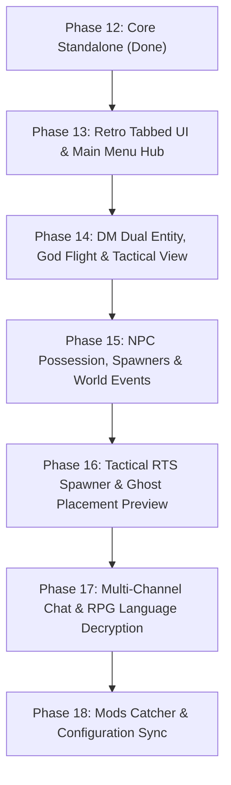

# PRD: DFUM TTRPG & Dungeon Master Master Suite (Phases 13 - 18)

## 1. Executive Summary & Vision

The objective of this initiative is to evolve **Daggerfall Unity Native Multiplayer (DFUM)** from a cooperative dungeon crawler into a comprehensive **Virtual Tabletop / TTRPG (Tabletop Role-Playing Game) Engine**, blending the procedural depth of Daggerfall with the live narrative control of systems like *Divinity: Original Sin 2 Game Master Mode* and *Arma 3 Zeus*.

A dedicated **Dungeon Master (DM)** can orchestrate adventures in real time: creating quests, possessing monsters and town NPCs, whispering secrets to specific players, altering weather and world events, and shaping encounters, while players communicate in-character using Daggerfall's native language skills.

---

## 2. Core Pillars

| Pillar | Description |
| :--- | :--- |
| **I. DM Orchestration & Possession** | Dual-mode DM (Spectator Spirit vs Physical Admin Avatar), full NPC body possession, world events, and complete creature/civilian spawner. |
| **II. RPG Communication & Languages** | Multi-channel chat, DM secret notes, whispers, and automatic ciphering/decryption based on DFU Language skills (*Orcish*, *Daedric*, *Dragonish*, etc.). |
| **III. Mods Catcher & Governance** | Strict 1:1 mod manifest verification, interactive conflict diagnostic modal, and authoritative replication of `modsettings.json` (Climates & Calories). |
| **IV. Tactical God Tools** | Freecam flight, top-down cenital tactical camera with zoom, RTS-style ghost puppet placement with collision validation, click-to-teleport, and customizable nametags/health bars. |
| **V. Cohesive Retro UX** | Unified tabbed pixel-art interface matching classic Daggerfall aesthetics and a native Multiplayer Main Menu for launching/joining sessions. |

---

## 3. Implementation Roadmap

---

### Phase 13: Retro Tabbed UI Suite & Multiplayer Main Menu Hub

**Goal:** Establish an organized, clean pixel-art UI architecture with tabs to replace cluttered debug windows, and create a native Main Menu entrypoint for starting and joining games.

#### Requirements:
1. **Unified Tabbed DM Suite (`DFU_TtrpgWindow`):**
   - Single clean modal replacing separate debug overlays (`Ctrl + F10`, `Ctrl + F11`, `Ctrl + F12`, `Ctrl + F7`).
   - Category tabs with pixel-art styling (Daggerfall parchment/stone border themes):
     - `[General / DM]`
     - `[Spawns & NPCs]`
     - `[Mundo & Eventos]`
     - `[Quests & Diálogos]`
     - `[Loot & Forja]`
     - `[Jugadores & Red]`
2. **Multiplayer Main Menu Integration:**
   - Adds **"Multiplayer"** directly to Daggerfall Unity's opening title screen.
   - Sub-menu with tabs:
     - `Crear Partida (Host Server)`: Port configuration, password, DM mode toggle.
     - `Unirse (Direct Connect)`: IP address, port, player name, character select.
     - `Historial de Servidores`: Saved favorites and recent IP connections.
     - `Mods & Compatibilidad`: Local mod status checklist.

---

### Phase 14: DM Dual Entity, God Flight & Tactical Cenital View

**Goal:** Enable the DM to switch dynamically between an invisible spectator and a physical admin character, navigate with full flight controls, and view the world from a top-down tactical perspective.

#### Requirements:
1. **Avatar / Spectator Switcher:**
   - **Spectator Mode (Zeus / Espíritu):** No physical collider, invisible to players, does not trigger mob aggro, consumes no fatigue/hunger, no environmental damage.
   - **Player Mode (Admin Avatar):** Physical presence with custom DM nametag/color, god mode toggle, and ability to speak in local chat directly.
   - Instant 1-key toggle between modes.
2. **God Flight & Tactical Cameras:**
   - **Noclip Free Flight:** WASD + Space/Ctrl with mouse scroll wheel for instant flight speed scaling (0.5x to 10x).
   - **Cenital / Top-Down View:** Locks camera overhead (orthogonal/tactical perspective) with smooth zoom to inspect battlefields and town squares.
   - **Click-to-Teleport:** Shift+Left Click on any ground surface instantly moves the DM or selected party members.
3. **Parametric Nametags & Health Visibility:**
   - Configurable overhead billboard text: Player Name, Career/Role, Distance, and optional mini Health Bar.
   - Color coding: Gold/Purple for DM, Cyan for party members, Red for hostile foes, Green for neutral NPCs.
   - Distance falloff setting (slider from 5m to 100m).

---

### Phase 15: NPC Possession, Expanded Spawner & World Events

**Goal:** Give the DM complete narrative agency to inhabit any living entity, spawn any creature/civilian in Daggerfall, and trigger environmental events.

#### Requirements:
1. **DM NPC Possession (`DM NPC Controller`):**
   - Raycast or click on any spawned mobile entity (`DaggerfallEntityBehaviour` / `MobilePersonNPC` / `EnemyMotor`) and click **"Poseer (Inhabit)"**.
   - The DM's camera anchors to the entity's perspective.
   - DM controls entity movement, melee/ranged attacks, and speaks through the entity in chat with custom overhead dialogue bubbles.
   - Pressing `Esc` or `F8` releases possession seamlessly and returns DM to previous avatar/spectator state.
2. **Complete Bestiary & NPC Catalog:**
   - Hierarchical spawner with search filter:
     - *Undead:* Skeletons, Zombies, Ghosts, Wraiths, Mummies, Liches, Vampire Ancients.
     - *Humanoids & Classes:* Guards, Assassins, Battlemages, Rogues, Knights, Thieves.
     - *Monsters & Daedra:* Daedroth, Fire/Frost Daedra, Dremora, Scamps, Harpies, Imps, Spiders, Scorpions, Werewolves, Wereboars.
     - *Town Civilians:* Men, women, merchants, tavern keepers with specific clothing/race models.
   - Level scaling override: Set custom HP, damage, and weapon materials before spawning.
3. **Loot Forge:**
   - Create custom items selecting Group (Weapons, Armor, Magic Items, Gems, Ingredients), Material (Iron to Daedric), Condition, and Enchantments.
   - Deposit directly into a clicked container/chest or drop on the ground.
4. **World Events Engine:**
   - Instant ambient sound triggers (thunder, distant screams, dragon roar, tavern lute).
   - Earthquake screen-shake effect.
   - Immediate weather and time manipulation (`set_weather`, `set_time`, `time_scale`).
5. **DM Economy & Rule Manipulation:**
   - Infinite gold minting, instant bounty purge, immunity to town crime triggers.

---

### Phase 16: Tactical RTS Spawner & Ghost Placement Preview

**Goal:** Provide the DM with precise, intuitive RTS-style placement of NPCs, monsters, and objects anywhere in the world using FreeCam / mouse raycasting, real-time collision validation, and local ghost puppet preview.

#### Requirements:
1. **Raycast Surface Targeting:**
   - Mouse-driven raycast intersecting geometry (ground terrain, dungeon floors, rooftops, stairs, building surfaces).
   - Dynamic normal alignment: Entity aligns upright to gravity with height offset to prevent clipping into surfaces.
   - Placement range unbounded or generous max distance (e.g., 150m) while operating in FreeCam / God Flight.
2. **Local Ghost Puppet Preview:**
   - Instantiates a purely local preview GameObject (ghost puppet) matching the selected catalog entity's billboard/mesh dimensions and collider.
   - Zero network replication while previewing: Other players receive zero network packets until placement is confirmed.
   - Follows mouse cursor in real-time along valid hit surfaces.
   - Mouse scroll wheel rotates entity facing direction prior to placement; `Right Click` or `Esc` cancels placement mode.
3. **Visual Validation Shader / Material Tint (Green / Red):**
   - Real-time overlap collision test (`Physics.OverlapCapsule` or bounds check against character layers / obstacles).
   - **Green Tint (Valid):** Clear surface with no overlapping entities/colliders and valid walkable/standable slope.
   - **Red Tint (Invalid):** Overlaps an existing player, NPC, monster collider, or hits an invalid obstruction (e.g. out-of-bounds void, steep vertical wall).
4. **Authoritative Confirmation & Spawn Dispatch:**
   - `Left Click` on valid (green) location confirms placement.
   - Host sends authoritative `MsgSpawnEnemy` or `MsgSpawnLoot` packet with the exact targeted position and orientation.
   - Cleans up local ghost puppet upon spawn or cancel.

---

### Phase 17: Multi-Channel Chat, Whispers & RPG Language Decryption

**Goal:** Implement an immersive in-character and out-of-character chat system that ties directly into Daggerfall's native linguistic skills.

#### Requirements:
1. **Channel Architecture:**
   - `/say` or Local Chat: Acoustic distance falloff (< 25m).
   - `/party` or `/p`: Party-wide broadcast.
   - `/w [player]` or Whisper: Private direct message between two players.
   - `/dm [player]`: Secret message from DM to player (and vice versa) for private perception checks or hallucinations.
   - `/ooc`: Out-of-character chat room.
   - `/roll [dice]` (e.g. `1d20+5`, `3d6`): Authoritative dice roller broadcasted to party or DM.
2. **Daggerfall Language Skill Scrambler:**
   - Active language dropdown in chat UI:
     - *Common / Tamrielic*
     - *Orcish*, *Dragonish*, *Daedric*, *Giantish*, *Harpy*, *Impish*, *Centaurian*, *Nymph*, *Spriggan*.
   - When Player A speaks in *Orcish*:
     - Server checks Player B's `PlayerEntity.Skills.GetPermanentSkillValue(DFGM_Skills.Orcish)`.
     - High skill: Player B reads normal text `[Orcish] "¡Ataquen por la retaguardia!"`.
     - Low/No skill: Player B reads scrambled guttural syllables `[Orcish] "Ghor lagash mog durat!"`.
     - The DM always reads the translated text with the source language tag.

---

### Phase 18: Mods Catcher & Configuration Replication

**Goal:** Ensure 100% mod parity across clients and authoritatively replicate gameplay rules (such as Climates & Calories) from Host to Clients.

#### Requirements:
1. **1:1 Mod Manifest Handshake:**
   - During network connection handshake, Client transmits `MsgModManifest` containing lists of all loaded `.dfmod` files, assembly versions, and file hashes.
   - Host compares against its own loaded mod list.
2. **Conflict & Mismatch Diagnostic Modal:**
   - If client is missing mods, has extra unapproved mods, or has version mismatches:
     - Connection is held in a diagnostic state.
     - A clear UI window displays:
       - **Faltantes:** Mods active on server that client must install.
       - **Sobrantes:** Mods active on client that are not allowed on server.
       - **Versión en Conflicto:** Mods with different versions.
       - Exact instructions and links to match the host setup.
3. **Authoritative `modsettings.json` Sync:**
   - When mods match 1:1, Host serializes its active `modsettings.json` configs (e.g. *Climates & Calories* temperature curves, thirst/hunger rates) and pushes them to connecting clients.
   - Clients apply host settings for the duration of the multiplayer session, restoring their local defaults on disconnect.
4. **Modding Installation Guide:**
   - Comprehensive documentation (`Docs/modding_guide_climates_and_calories.md`) covering installation, compatible mods, and configuration guidelines.

---

## 4. Architectural Rules & Technical Constraints

1. **Native Integration:** All UI and TTRPG logic lives inside `Assets/Scripts/Game/Networking/` or `Assets/Scripts/Game/UserInterfaceWindows/`.
2. **Deterministic Language Checks:** Language translation checks occur on the recipient client (or server-evaluated) using DFU's authoritative character sheet stats.
3. **Clean Session Teardown:** Possession and God flight must cleanly restore motor controllers, colliders, and player layers on exit or disconnect to prevent soft-locks.
4. **Ghost Puppet Isolation:** Ghost placement previews are strictly client-side local objects and must never instantiate network behaviors, register in `DFUNetworkRegistry`, or allocate network IDs until confirmed.
