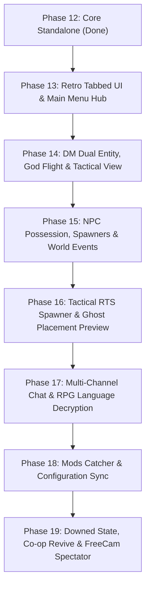

# PRD: DFUM TTRPG & Dungeon Master Master Suite (Phases 13 - 19)

## 1. Executive Summary & Vision

The objective of this initiative is to evolve **Daggerfall Unity Native Multiplayer (DFUM)** from a cooperative dungeon crawler into a comprehensive **Virtual Tabletop / TTRPG (Tabletop Role-Playing Game) Engine**, blending the procedural depth of Daggerfall with the live narrative control of systems like *Divinity: Original Sin 2 Game Master Mode* and *Arma 3 Zeus*.

A dedicated **Dungeon Master (DM)** can orchestrate adventures in real time: creating quests, possessing monsters and town NPCs, whispering secrets to specific players, altering weather and world events, and shaping encounters, while players communicate in-character using Daggerfall's native language skills.

---

## 2. Core Pillars

| Pillar | Description |
| :--- | :--- |
| **I. DM Orchestration & Possession** | Dual-mode DM (Spectator Spirit vs Physical Admin Avatar), full NPC body possession, world events, and complete creature/civilian spawner. |
| **II. RPG Communication & Languages** | Multi-channel chat, DM secret notes, whispers, and automatic ciphering/decryption based on DFU Language skills (*Orcish*, *Daedric*, *Dragonish*, etc.). |
| **III. Mods Catcher & Governance** | Strict 1:1 mod manifest verification, interactive conflict diagnostic modal, and authoritative replication of `modsettings.json` (Climates & Calories). |
| **IV. Tactical God Tools** | Freecam flight, top-down cenital tactical camera with zoom, RTS-style ghost puppet placement with collision validation, click-to-teleport, and customizable nametags/health bars. |
| **V. Cohesive Retro UX** | Unified tabbed pixel-art interface matching classic Daggerfall aesthetics and a native Multiplayer Main Menu for launching/joining sessions. |
| **VI. Party Survival & Anti-Desync Lifecycle** | 3-minute unconscious downed state, ally resuscitation via spells/potions, and seamless FreeCam spectator transition to eliminate death reload desyncs. |

---

## 3. Implementation Roadmap

---

### Phase 13: Retro Tabbed UI Suite & Multiplayer Main Menu Hub

**Goal:** Establish an organized, clean pixel-art UI architecture with tabs to replace cluttered debug windows, and create a native Main Menu entrypoint for starting and joining games.

#### Requirements:
1. **Unified Tabbed DM Suite (`DFU_TtrpgWindow`):**
   - Single clean modal replacing separate debug overlays (`Ctrl + F10`, `Ctrl + F11`, `Ctrl + F12`, `Ctrl + F7`).
   - Category tabs with pixel-art styling (Daggerfall parchment/stone border themes):
     - `[General / DM]`
     - `[Spawns & NPCs]`
     - `[Mundo & Eventos]`
     - `[Quests & Diálogos]`
     - `[Loot & Forja]`
     - `[Jugadores & Red]`
2. **Multiplayer Main Menu Integration:**
   - Adds **"Multiplayer"** directly to Daggerfall Unity's opening title screen.
   - Sub-menu with tabs:
     - `Crear Partida (Host Server)`: Port configuration, password, DM mode toggle.
     - `Unirse (Direct Connect)`: IP address, port, player name, character select.
     - `Historial de Servidores`: Saved favorites and recent IP connections.
     - `Mods & Compatibilidad`: Local mod status checklist.

---

### Phase 14: DM Dual Entity, God Flight & Tactical Cenital View

**Goal:** Enable the DM to switch dynamically between an invisible spectator and a physical admin character, navigate with full flight controls, and view the world from a top-down tactical perspective.

#### Requirements:
1. **Avatar / Spectator Switcher:**
   - **Spectator Mode (Zeus / Espíritu):** No physical collider, invisible to players, does not trigger mob aggro, consumes no fatigue/hunger, no environmental damage.
   - **Player Mode (Admin Avatar):** Physical presence with custom DM nametag/color, god mode toggle, and ability to speak in local chat directly.
   - Instant 1-key toggle between modes.
2. **God Flight & Tactical Cameras:**
   - **Noclip Free Flight:** WASD + Space/Ctrl with mouse scroll wheel for instant flight speed scaling (0.5x to 10x).
   - **Cenital / Top-Down View:** Locks camera overhead (orthogonal/tactical perspective) with smooth zoom to inspect battlefields and town squares.
   - **Click-to-Teleport:** Shift+Left Click on any ground surface instantly moves the DM or selected party members.
3. **Parametric Nametags & Health Visibility:**
   - Configurable overhead billboard text: Player Name, Career/Role, Distance, and optional mini Health Bar.
   - Color coding: Gold/Purple for DM, Cyan for party members, Red for hostile foes, Green for neutral NPCs.
   - Distance falloff setting (slider from 5m to 100m).

---

### Phase 15: NPC Possession, Expanded Spawner & World Events

**Goal:** Give the DM complete narrative agency to inhabit any living entity, spawn any creature/civilian in Daggerfall, and trigger environmental events.

#### Requirements:
1. **DM NPC Possession (`DM NPC Controller`):**
   - Raycast or click on any spawned mobile entity (`DaggerfallEntityBehaviour` / `MobilePersonNPC` / `EnemyMotor`) and click **"Poseer (Inhabit)"**.
   - The DM's camera anchors to the entity's perspective.
   - DM controls entity movement, melee/ranged attacks, and speaks through the entity in chat with custom overhead dialogue bubbles.
   - Pressing `Esc` or `F8` releases possession seamlessly and returns DM to previous avatar/spectator state.
2. **Complete Bestiary & NPC Catalog:**
   - Hierarchical spawner with search filter:
     - *Undead:* Skeletons, Zombies, Ghosts, Wraiths, Mummies, Liches, Vampire Ancients.
     - *Humanoids & Classes:* Guards, Assassins, Battlemages, Rogues, Knights, Thieves.
     - *Monsters & Daedra:* Daedroth, Fire/Frost Daedra, Dremora, Scamps, Harpies, Imps, Spiders, Scorpions, Werewolves, Wereboars.
     - *Town Civilians:* Men, women, merchants, tavern keepers with specific clothing/race models.
   - Level scaling override: Set custom HP, damage, and weapon materials before spawning.
3. **Loot Forge:**
   - Create custom items selecting Group (Weapons, Armor, Magic Items, Gems, Ingredients), Material (Iron to Daedric), Condition, and Enchantments.
   - Deposit directly into a clicked container/chest or drop on the ground.
4. **World Events Engine:**
   - Instant ambient sound triggers (thunder, distant screams, dragon roar, tavern lute).
   - Earthquake screen-shake effect.
   - Immediate weather and time manipulation (`set_weather`, `set_time`, `time_scale`).
5. **DM Economy & Rule Manipulation:**
   - Infinite gold minting, instant bounty purge, immunity to town crime triggers.

---

### Phase 16: Tactical RTS Spawner & Ghost Placement Preview

**Goal:** Provide the DM with precise, intuitive RTS-style placement of NPCs, monsters, and objects anywhere in the world using FreeCam / mouse raycasting, real-time collision validation, and local ghost puppet preview.

#### Requirements:
1. **Raycast Surface Targeting:**
   - Mouse-driven raycast intersecting geometry (ground terrain, dungeon floors, rooftops, stairs, building surfaces).
   - Dynamic normal alignment: Entity aligns upright to gravity with height offset to prevent clipping into surfaces.
   - Placement range unbounded or generous max distance (e.g., 150m) while operating in FreeCam / God Flight.
2. **Local Ghost Puppet Preview:**
   - Instantiates a purely local preview GameObject (ghost puppet) matching the selected catalog entity's billboard/mesh dimensions and collider.
   - Zero network replication while previewing: Other players receive zero network packets until placement is confirmed.
   - Follows mouse cursor in real-time along valid hit surfaces.
   - Mouse scroll wheel rotates entity facing direction prior to placement; `Right Click` or `Esc` cancels placement mode.
3. **Visual Validation Shader / Material Tint (Green / Red):**
   - Real-time overlap collision test (`Physics.OverlapCapsule` or bounds check against character layers / obstacles).
   - **Green Tint (Valid):** Clear surface with no overlapping entities/colliders and valid walkable/standable slope.
   - **Red Tint (Invalid):** Overlaps an existing player, NPC, monster collider, or hits an invalid obstruction (e.g. out-of-bounds void, steep vertical wall).
4. **Authoritative Confirmation & Spawn Dispatch:**
   - `Left Click` on valid (green) location confirms placement.
   - Host sends authoritative `MsgSpawnEnemy` or `MsgSpawnLoot` packet with the exact targeted position and orientation.
   - Cleans up local ghost puppet upon spawn or cancel.

---

### Phase 17: Multi-Channel Chat, Whispers & RPG Language Decryption

**Goal:** Implement an immersive in-character and out-of-character chat system that ties directly into Daggerfall's native linguistic skills.

#### Requirements:
1. **Channel Architecture:**
   - `/say` or Local Chat: Acoustic distance falloff (< 25m).
   - `/party` or `/p`: Party-wide broadcast.
   - `/w [player]` or Whisper: Private direct message between two players.
   - `/dm [player]`: Secret message from DM to player (and vice versa) for private perception checks or hallucinations.
   - `/ooc`: Out-of-character chat room.
   - `/roll [dice]` (e.g. `1d20+5`, `3d6`): Authoritative dice roller broadcasted to party or DM.
2. **Daggerfall Language Skill Scrambler:**
   - Active language dropdown in chat UI:
     - *Common / Tamrielic*
     - *Orcish*, *Dragonish*, *Daedric*, *Giantish*, *Harpy*, *Impish*, *Centaurian*, *Nymph*, *Spriggan*.
   - When Player A speaks in *Orcish*:
     - Server checks Player B's `PlayerEntity.Skills.GetPermanentSkillValue(DFGM_Skills.Orcish)`.
     - High skill: Player B reads normal text `[Orcish] "¡Ataquen por la retaguardia!"`.
     - Low/No skill: Player B reads scrambled guttural syllables `[Orcish] "Ghor lagash mog durat!"`.
     - The DM always reads the translated text with the source language tag.
3. **Interactive Visual D20 Tray & BG3-Style DC Skill Challenges:**
   - **Top-Center Puller Tab:** Downward triangular tab at top-center of screen that toggles a pixel-art D20 dice tray.
   - **Free Rolls:** Any player can pull the tray and roll a 1D20 at any time for spontaneous tabletop checks.
   - **DM DC Challenge System:**
     - DM configures Challenge Reason (e.g. *Perception Check*, *Athletics*), target DC (Difficulty Class, e.g. 15), and a checkbox to show/hide the DC from players.
     - Broadcasts challenge to party; tray unfolds automatically on clients.
     - First player to roll submits the active check result.
   - **Rolling Suspense & Animation:** The die tumbles with shuffling numbers and audio rattles for ~1.8 seconds before locking in.
   - **Evaluation & Feedback:**
     - **Nat 20:** *¡Éxito Crítico!* highlighted in radiant gold.
     - **Nat 1:** *¡Fallo Crítico!* highlighted in crimson red.
     - **Success / Fail:** Evaluated against DC (if hidden, displays whether passed without revealing exact DC).
     - Authoritative broadcast to all connected players with Dark Fantasy pixel-art banner.

---

### Phase 18: Mods Catcher & Configuration Replication (Implemented)

**Goal:** Ensure 100% mod parity across clients and authoritatively replicate gameplay rules (such as Climates & Calories) from Host to Clients.

#### Implemented Features:
1. **1:1 Mod Manifest Handshake (`MsgModManifestReport` & `MsgModCompatibilityResponse`):**
   - Transmits active `.dfmod` files, versions, and cryptographic SHA-256 hashes computed via [`DFUModSyncController.cs`](file:///D:/11%20Workspace/17%20DFU-Multiplayer/Assets/Scripts/Game/Networking/DFUModSyncController.cs).
   - Host validates 1:1 parity, categorizing conflicts into Missing, Extra, and Mismatched mods.
2. **Conflict & Mismatch Diagnostic Modal ([`DFUModConflictModalWindow.cs`](file:///D:/11%20Workspace/17%20DFU-Multiplayer/Assets/Scripts/Game/UserInterfaceWindows/DFUModConflictModalWindow.cs)):**
   - In Pre-Game Lobby (`Tab 2`), parity conflicts lock the Ready button with `[!] CONFLICTO MODS (VER)`.
   - Displays a 320x200 pixel-art modal detailing missing mods, extra unapproved mods, and version/hash differences.
   - Host Launch button remains locked until all clients achieve 100% parity.
3. **Authoritative `modsettings.json` Sync & Rollback (`MsgModSettingsSync`):**
   - Host pushes active configurations (e.g. *Climates & Calories* survival parameters) to verified clients.
   - Client backs up local settings to `modsettings.mp_backup.json`, live-applies Host settings via `mod.LoadSettings()`.
   - On disconnect (`OnStopClient`), seamlessly restores local client settings and deletes temporary backups.
4. **Documentation & Testing:**
   - Modding Guide: [`Docs/modding_guide_climates_and_calories.md`](file:///D:/11%20Workspace/17%20DFU-Multiplayer/Docs/modding_guide_climates_and_calories.md).
   - Manual Testing: [`Docs/testing_docs/manual-testing-phase-18-mods-catcher-and-config-sync.md`](file:///D:/11%20Workspace/17%20DFU-Multiplayer/Docs/testing_docs/manual-testing-phase-18-mods-catcher-and-config-sync.md).

---

### Phase 19: Downed State, Cooperative Revive & FreeCam Spectator (Anti-Desync Lifecycle)

**Goal:** Eliminate multiplayer desynchronization, scene reloading, and sudden client dropouts caused by vanilla DFU's single-player death sequence (`TitleMenuFromDeath`). Replace instant death at 0 HP with a 3-minute unconscious downed state (bleeding out) where party members can heal/resuscitate the fallen character, followed by a seamless transition into FreeCam Spectator mode if the bleedout timer expires.

#### Background & Root-Cause Analysis:
- In vanilla single-player Daggerfall Unity, when `PlayerEntity.CurrentHealth <= 0`, `PlayerDeath.cs` takes over: input is paused, the camera tilts to the floor, the screen fades to black, and after 3 seconds (`TimeBeforeReset`), `StartGameBehaviour.StartMethods.TitleMenuFromDeath` triggers.
- In a multiplayer context, this single-player reset routine triggers scene unloads, destroys player objects, tears down local networking state, and leaves remote puppets orphaned, causing massive world desynchronization for the server and remaining clients.

#### Requirements:
1. **Unconscious / Downed State Interception (Bleeding Out):**
   - Intercept `PlayerEntity.OnDeath` or health reduction reaching `<= 0` on multiplayer clients.
   - Prevent execution of `PlayerDeath.cs`'s transition to `TitleMenuFromDeath`.
   - The player enters an **Inconsciente (Downed)** state:
     - Health is pinned at 0 (or a protected non-fatal downed status).
     - Standard movement, weapon swings, spellcasting, and jumping are disabled (`PlayerMotor.CancelMovement = true`).
     - The player's puppet enters a prone/collapsed animation state (`animState = Downed/Die`) visible and synchronized across all connected players.
     - The downed player's screen displays a desaturated/vignette overlay with an audible heartbeat and an onscreen countdown timer: `[Inconsciente] Desangrándote: 03:00`.
     - Downed players retain access to party chat (`/party`, `/say`) to call out for help and communicate with the group.
2. **Cooperative Resuscitation & Healing Mechanics:**
   - Any party member within proximity (< 2.5 meters) can stabilize and revive the fallen player through standard RPG actions:
     - **Healing Spells:** Casting any targeted restoration/healing spell on or near the downed player immediately revives them with health equal to the spell's magnitude.
     - **Potions & First Aid:** Using a healing potion from inventory on the downed player (or holding an interact button for 3 seconds) restores a baseline percentage of health (e.g. 15% Max HP) and wakes them up.
     - **DM Divine Resurrect:** The DM can directly select the downed player in the DM Suite (`Ctrl + F10`) and click `✦ Revivir / Resucitar ✦` to instantly restore them to full health.
   - **Wake-up Transition:** Upon receiving healing:
     - The downed status clears, camera and HUD restore to normal, standard player motor and combat controls re-enable.
     - Remote puppet stands up and resumes standard idle/walk animations.
     - Broadcasts notification: `[Party] ¡{PlayerName} ha sido reanimado por {HealerName}!`.
3. **Bleedout Expiration & FreeCam Spectator Mode:**
   - If the 3-minute timer reaches 00:00 without resuscitation:
     - The character officially expires (`MsgPlayerPermaDeath`).
     - The physical body/puppet remains on the ground as a permanent corpse marker (or lootable container if enabled).
     - **Seamless Spectator FreeCam:** Instead of disconnecting or resetting to the title menu, the player's client immediately activates `FreeCamController` in spectator mode:
       - No physical collider, invisible, able to fly freely through dungeons and wilderness.
       - Chat (`/party`, `/say`, `/ooc`) remains completely functional so the player stays engaged with the table until the session concludes.
       - The NetworkClient connection, scene state, and synchronization loops remain 100% active and healthy.
4. **Network Synchronization Messages:**
   - `MsgPlayerDowned`: Informs the server and clients that a player has collapsed at a specific position, synchronizing the downed pose and starting the 3-minute timer.
   - `MsgPlayerRevive`: Dispatched when healing is applied, authoritatively restoring player state and health.
   - `MsgPlayerPermaDeath`: Dispatched on timer timeout to spawn permanent corpse and switch victim to spectator mode.
5. **Documentation & Testing:**
   - Manual Testing: [`Docs/testing_docs/manual-testing-phase-19-downed-state-and-spectator.md`](file:///D:/11%20Workspace/17%20DFU-Multiplayer/Docs/testing_docs/manual-testing-phase-19-downed-state-and-spectator.md).

### Phase 20: Cooperative Party Restoration, Shared Buffs & Non-Magical First Aid

1. **Party Smart-Support Spell Adapter:**
   - Resolves the single-player legacy constraint where all baseline Restoration and Buff spells are hardcoded to `TargetTypes.CasterOnly`.
   - Introduces an authoritative Targeting Adapter:
     - When a player has a beneficial or curative spell readied (Heal Health/Fatigue/Magicka, Cure Poison/Paralysis/Disease, Levitate, Water Breathing, Invisibility, Resistances), holding a designated Support Modifier key (or aiming crosshair directly at an allied player puppet / allied NPC within 4 meters) re-routes the cast payload to the targeted entity.
     - Automatically serializes and routes the `EntityEffectBundle` over Mirror RPCs (`SendSpellPayloadToPlayer`), executing cleanly on the recipient's `PlayerEffectManager`.
2. **Area of Effect (AoE) Aura Synchronization:**
   - Spells created with `TargetTypes.AreaAroundCaster` or `TargetTypes.AreaAtRange` intelligently identify party puppets in radius:
     - Harmful effects respect `net_pvp` friendly-fire toggle.
     - Beneficial effects (Mass Cure, Aura of Protection, Group Levitate, Light) are automatically multi-cast and applied to all friendly party members within the blast radius without manual single-target aiming.
3. **Non-Magical First Aid & Consumable Injection:**
   - Supports non-caster classes (Warriors, Rogues, Rangers) who lack Magicka pools:
     - **Direct Potion Application:** Players can use healing, stamina, or antidote potions from inventory directly on a targeted party member in melee range (< 2.5m) or via the Player Interaction Menu.
     - **Field Medic (Medical Skill):** Using bandages or rest kits applies a Medical check to restore fatigue and stabilize bleeding companions.
4. **Allied NPC & Summon Support:**
   - Beneficial spells and touch payloads applied to friendly/summoned creatures (Atronachs, pacified beasts, escort quest NPCs) restore health without triggering hostility or combat aggro.
5. **Network Protocol & Messages:**
   - `MsgPartySupportAction`: Routes direct non-spell healing actions (potions, medical bandages) with authoritative consumable consumption.
   - Extends `MsgApplySpellBundle` with support-tagging and friendly target acknowledgment.
6. **Documentation & Testing:**
   - Manual Testing: `Docs/testing_docs/manual-testing-phase-20-cooperative-restoration-and-buffs.md`.

### Phase 21: Party Justice, World Stasis & Narrative Prison Escapes

1. **Guard Arrest & Combat Stasis (Stand Down):**
   - Intercepts guard combat cycles upon arrest initiation.
   - When a city guard triggers `SurrenderToGuardsDialogue`, all guards in a 25m radius immediately halt attacks and enter a non-hostile stand-down state.
   - The accused player receives authoritative combat stasis (immunity to guard and external damage while interacting with dialogue and court proceedings).
2. **Synchronized Courtroom & Party Broadcast:**
   - The defendant player alone interacts with the trial interface (`DaggerfallCourtWindow`), entering pleas and arguments.
   - Remote party peers receive a synchronized HUD broadcast: `✦ TRIBUNAL EN SESIÓN ✦`, displaying the defendant's name, jurisdiction, charges, and verdict.
3. **Imprisonment, Inmate Escape & "Choose Your Own Adventure" Party Jailbreak:**
   - Completely suppresses legacy single-player destructive `RaiseTime` skips during jail sentences.
   - Presents a dedicated Dark Fantasy Pixel Art interactive window featuring 3 distinct gameplay paths:
     - **Serve Sentence (Communal Wait):** The party waits out the sentence collectively via the synchronized party rest/wait system.
     - **Inmate Solo Escape Roll (D20 Check):** The imprisoned player attempts an escape roll inside the dungeon cell. Success breaks them out to the city entrance as a wanted fugitive; failure doubles the prison sentence.
     - **Party Jailbreak (Choose Your Own Adventure):** Allied party members initiate a 3-stage branching rescue adventure (e.g. Infiltrate Guardhouse -> Picklock/Bribe Jailer -> Escape & Evacuation). The DM configures the DC checks in real time via the DM Suite dice tray. If the party succeeds all 3 checks, the prisoner is freed. If any check fails, the rescuers are arrested and imprisoned together.
4. **Vampirism & Lycanthropy Anti-Skip Lifecycle:**
   - Transformation dream and nightmare cinematics play locally for the infected player only, granting combat stasis while viewing.
   - Suppresses the classic 14-day time leap in `DeployFullBlownVampirism`. Time progresses day-by-day in real time.
   - During the vampiric lethargy phase, the player views a placeholder screen: `[Acá va video en loop - Letargo Vampírico]`.
   - The sleeping player can participate in party rest votes to accelerate the days collectively.
   - Upon completion, the transformed player awakens in the cemetery crypt without temporal desync.
5. **Shared Daedric Invocations & Cutscene Stasis:**
   - When a party member invokes a Daedric Prince at a coven/shrine or activates a main story video (`DaggerfallVidPlayerWindow`), the video is synchronized and played for all connected peers.
   - All party members are granted total damage stasis for the duration of the cutscene.
6. **Silent Dungeon Teleport Traps & Kidnappings:**
   - Teleport pads and quest traps silently relocate the victim without chat spoiler announcements, preserving authentic TTRPG mystery and organic party search efforts.
7. **Synchronized Guild Training & Temple Healing:**
   - Services requiring hours of rest/training (guild skill training, temple disease recovery) dispatch `MsgPartyWaitVote`.
   - Time advances authoritatively on the server only upon unanimous party consent.
8. **Communal Rest Ambush Awakening:**
   - Enemy spawns during rest wake up all sleeping players simultaneously, granting a 3-second defensive reaction stasis to prevent instant darkness deaths.
9. **Documentation & Testing:**
   - Manual Testing: `Docs/testing_docs/manual-testing-phase-21-party-justice-and-world-stasis.md`.

---

## 4. Architectural Rules & Technical Constraints

1. **Native Integration:** All UI and TTRPG logic lives inside `Assets/Scripts/Game/Networking/` or `Assets/Scripts/Game/UserInterfaceWindows/`.
2. **Deterministic Language Checks:** Language translation checks occur on the recipient client (or server-evaluated) using DFU's authoritative character sheet stats.
3. **Clean Session Teardown:** Possession and God flight must cleanly restore motor controllers, colliders, and player layers on exit or disconnect to prevent soft-locks.
4. **Ghost Puppet Isolation:** Ghost placement previews are strictly client-side local objects and must never instantiate network behaviors, register in `DFUNetworkRegistry`, or allocate network IDs until confirmed.
5. **Anti-Desync Player Lifecycle:** Under no circumstances may player death trigger vanilla `StartGameBehaviour.StartMethods.TitleMenuFromDeath` during an active multiplayer session. `PlayerEntity.OnDeath` must be intercepted authoritatively to transition the player into the 3-minute Downed state or Spectator FreeCam mode, keeping the NetworkClient connection, scene root, and entity synchronization active.
