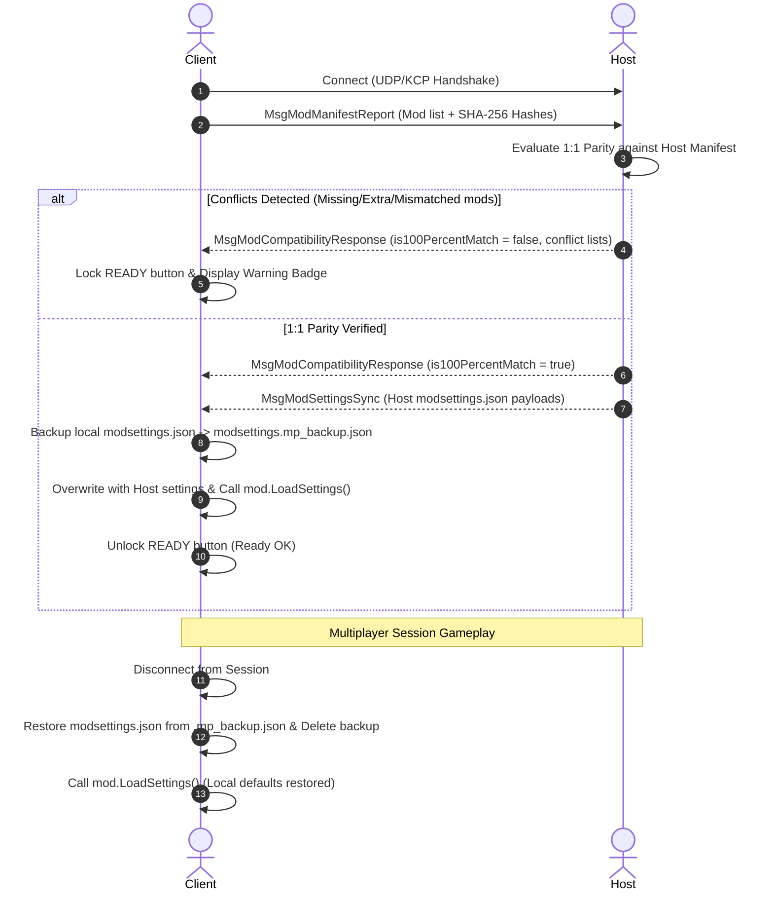

# Daggerfall Unity Multiplayer: Modding Guide & Climates & Calories Integration

## Overview
In DFU Multiplayer (DFUM), game balance and simulation mechanics depend heavily on deterministic parity between all connected players. When a player installs gameplay altering mods—particularly survival overhauls like **Climates & Calories (C&C)**—discrepancies in loaded assets, simulation ticks, or temperature curves can cause severe desynchronization, phantom damage, or desynced weather statuses.

**Phase 18 (Mods Catcher & Configuration Replication)** establishes a zero-desync mod architecture:
1. **1:1 Mod Manifest Handshake:** The server validates that all connecting clients run the exact same active `.dfmod` bundles with matching versions and cryptographic SHA-256 checksums.
2. **Authoritative `modsettings.json` Sync:** The Host/DM's custom mod configurations (e.g. food decay rate, cold vulnerability, thirst intervals) are broadcast to clients upon entering the session.
3. **Session Sandbox & Rollback:** The client temporarily applies the Host's rules with live reloading (`mod.LoadSettings()`). Upon disconnecting, the client's local `.mp_backup.json` settings are seamlessly restored without data loss.

---

## 1. Climates & Calories (C&C) in Multiplayer

*Climates & Calories* by Ralzar is one of the most immersive survival and environmental mods for Daggerfall Unity. It simulates:
- **Temperature & Climate Exposure:** Hypothermia in mountain snowstorms, heat exhaustion in the Alik'r Desert, protection provided by cloaks and armor.
- **Thirst & Hunger:** Real-time metabolic rates requiring rations, water, and hunting.
- **Camping & Shelter:** Pitching tents, lighting campfires, resting in taverns.
- **Sleep Exhaustion:** Penalties to attributes when characters go days without sleeping.

### Multiplayer Cooperative Synergy
- When the party rests together around a campfire or inside an inn, all players recover temperature and fatigue in sync.
- The Dungeon Master can inspect character hunger/thirst/temperature statuses in real time via the TTRPG Master Suite (`Ctrl + Shift + F10`).
- The Host controls the survival difficulty curve for the entire campaign via authoritative configuration replication.

---

## 2. Installation Guide for Players & Host

### Step 1: Locating the Mods Directory
1. Open your Daggerfall Unity installation directory.
2. Navigate to:
   - **Windows:** `<DaggerfallUnity_Folder>/DaggerfallUnity_Data/StreamingAssets/Mods/`
   - Alternatively, persistent user mods are located at:
     `%USERPROFILE%/AppData/LocalLow/Daggerfall Workshop/Daggerfall Unity/Mods/`

### Step 2: Installing Climates & Calories
1. Download the latest compatible release of **Climates & Calories** (`climates-and-calories.dfmod`) from NexusMods.
2. Place `climates-and-calories.dfmod` inside the `StreamingAssets/Mods/` directory on both the **Host's computer** and **all Client machines**.
3. If using companion immersion mods (e.g. *Travel Options*, *Basic Roads*, *Warm Ashes*), ensure every player in the session installs the exact same files.

### Step 3: Enabling the Mod in DFU Mod Loader
1. Launch Daggerfall Unity.
2. On the main title menu, click the **Enhancements / Mods** button.
3. Verify that `climates-and-calories` appears in the list.
4. Ensure the checkbox next to the mod is **Checked / Enabled**.
5. Adjust load priority if necessary (recommended load order: core libraries first, then overhauls).

---

## 3. How Configuration Sync Works in Phase 18

---

## 4. Mod Parity Conflict Diagnostics

If a client encounters a mismatch, clicking **`[!] CONFLICTO MODS (VER)`** in the Pre-Game Lobby opens the **Mod Conflict Diagnostics Modal**:

| Conflict Type | Description | Resolution |
| :--- | :--- | :--- |
| **MODS FALTANTES** | The Host has an active mod that your client does not have installed. | Download and install the listed `.dfmod` file into your `Mods/` folder. |
| **MODS SOBRANTES** | Your client has an active mod that is absent or unapproved on the Host. | Go to the main title screen **Mods** menu and uncheck/disable the listed mod. |
| **VERSION / CHECKSUM MISMATCH** | The mod exists on both machines, but the version or SHA-256 file hash differs (e.g. modified code or different release). | Re-download the official release of the mod to match the Host's exact version. |

---

## 5. Summary of Best Practices for DFU Multiplayer Modding
- **Always update together:** Whenever a mod is updated, distribute the exact same `.dfmod` file to all group members.
- **Never manually edit `modsettings.json` while connected:** The Host's rules will overwrite session settings automatically. Make permanent local changes while offline.
- **Virtual Mods in Editor:** When testing in Unity Editor with Virtual Mods enabled, the system computes metadata-based hashes to ensure editor-to-build compatibility.
