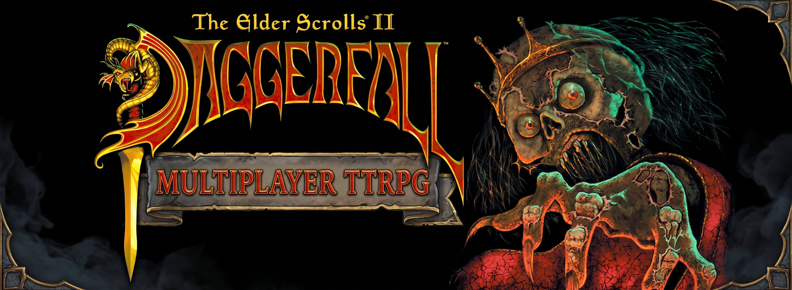

<p align="center">
  
</p>

# DFUM: Dungeon Master
### *Native Multiplayer & Tabletop RPG Virtual Engine for Daggerfall Unity*

[](https://unity.com/)
[](https://mirror-networking.gitbook.io/docs)
[]()
[](LICENSE)
[]()

**DFUM: Dungeon Master** transforms [Daggerfall Unity](https://www.dfworkshop.net/) into an immersive, collaborative **Tabletop RPG (TTRPG) Virtual Engine**. One player steps into the role of the **Dungeon Master (DM)** with authoritative real-time control over encounters, world events, weather, and narrative pacing, while adventurers explore the 15,000+ cities, dungeons, and wilderness of the Iliac Bay together in true cooperative multiplayer.

---

## 🌟 Core Gameplay Pillars

### 🏰 1. Pre-Game Lobby & Character Staging
- **Native Start Menu Integration:** Launch, host, and join multiplayer sessions directly from Daggerfall's retro title screen without needing external launchers or console setup.
- **Pre-Game Assembly Room:** Gather your adventuring party in a synchronized lobby before stepping foot in the Iliac Bay.
- **Character Selection & Creation:** Seamlessly create a brand new character through Daggerfall's classic class wizard or choose from your existing local save files with instant previews of name, race, class, and level.
- **Server History & Mod Diagnostic:** Automatically saves favorite connections for 1-click rejoining and validates active mod compatibility between host and connecting clients.

### 🎭 2. Comprehensive Dungeon Master Suite
- **Live Creature & NPC Spawning:** The DM can dynamically summon over 30+ bestiary creatures, undead horrors, Daedric entities, town guards, and civilians anywhere in the world to react to party choices.
- **Environmental & Time Mastery:** Shift the world clock (Dawn, Noon, Dusk, Midnight) or alter weather patterns (Sunny, Heavy Rain, Snow, Thunderstorms, Dense Fog) instantly across all players.
- **Party Teleportation & Gathering:** Gather scattered adventurers into dungeons, taverns, or wilderness camps with automatic cell synchronization.
- **DM Stealth & God Mode:** Observe party decisions unseen and unhindered by enemy aggro or town crime laws using complete DM invisibility and invincibility.
- **Role-Based Security:** Non-DM clients enjoy transparent visibility of the suite while DM-exclusive tools remain securely locked to the game master.

### 📜 3. Cooperative Quests & Consensus Contracts
- **Party Consensus Voting:** When a player or NPC offers an adventure, the party receives a parchment contract with an opt-in voting window so everyone decides together.
- **Synchronized Objectives & Dungeons:** Quests generate deterministic dungeon sites, targets, and NPC turn-ins synchronized across every party member.
- **Shared Boss Battles:** Quest targets and legendary foes intelligently replicate combat states, advancing objectives and quest logs party-wide upon defeat.

### 💬 4. Proximity Socializing & Acoustic Dialogue
- **3D Overhead Speech Bubbles:** Conversations with town NPCs and other players appear as floating dialogue bubbles naturally anchored over speakers' heads.
- **Acoustic Distance Falloff:** Speech volume and bubble opacity fade naturally based on distance, creating realistic room acoustics inside bustling taverns and cavernous dungeons.
- **Bilateral Player Trading:** Approach fellow party members in the world to open an interactive trading window for exchanging gold, weapons, armor, and enchanted gear.

### ⚔️ 5. Authoritative Combat, Looting & Resting
- **Multi-Target Combat AI:** Enemies dynamically assess threat and proximity across the entire party, coordinating attacks against melee fighters, archers, and spellcasters alike.
- **Material Hit Immunities:** Server-authoritative material checks guarantee that only appropriate metal types (silver, mithril, Daedric) can pierce magical beasts, ghosts, and werewolves.
- **Synchronized Corpse Looting:** Defeated monsters and bandits leave persistent, lootable corpses that party members can search simultaneously.
- **Party Rest Voting:** Coordinate resting and camping in taverns or around wilderness campfires with synchronized blackout transitions and natural health recovery.

### 🦅 6. Tactical DM Observation, Possession & RTS Placement
- **Decoupled Flight Mode:** The DM can decouple their view into 6-DOF freecam flight to scout upcoming dungeon chambers or oversee large open-field battles from above.
- **Full NPC Body Possession:** Inhabit any living creature, guard, or civilian to control movement, melee attacks, and speak in-character with custom speech bubbles.
- **Tactical RTS Ghost Spawner:** Preview creature placement with ground-projected colored bounds and terrain validation before committing spawns.

### 🎲 7. BG3-Style D20 Dice Tray & RPG Language Ciphers (Phase 17)
- **Interactive D20 Dice Tray:** Animated 3D tumbling icosahedron with realistic felt bounces, sound effects, Nat 20 critical triumphs, and Nat 1 fumbles.
- **Live DM Challenge Composer:** The DM issues party-wide or target DC skill challenges with dramatic outcome banners.
- **Multi-Channel Chat:** Tabs for `/say`, `/party`, `/whisper`, `/dm`, `/ooc`, `/roll`, and `/system`.
- **In-Character Language Decryption:** Real-time ciphering of Tamrielic tongues (*Orcish*, *Daedric*, *Dragonish*, *Giantish*, *Nedic*, etc.) based on character sheet linguistic proficiencies.

### 📦 8. Strict 1:1 Mod Catcher & Config Sync (Phase 18)
- **Cryptographic Mod Verification:** SHA-256 hash validation during lobby handshake prevents desyncs caused by mod version mismatches.
- **Interactive Diagnostic Modal:** Pinpoints missing, extra, or modified `.dfmod` files with clear remediation guidance.
- **Authoritative Configuration Sync:** Replicates gameplay parameters (such as *Climates & Calories* temperature and nutritional requirements) from host to connecting clients.

### 🩸 9. Downed State, Co-op Revives & Spectator FreeCam (Phase 19)
- **Unconscious Bleedout State:** Eliminates single-player death reload desyncs; dropping to 0 HP initiates a 3-minute heartbeat bleedout countdown.
- **Cooperative Resuscitation:** Allies can revive fallen companions using targeted healing spells, inventory potions, field first aid, or DM Divine Resurrect.
- **Seamless Spectator Mode:** If the timer expires, the player smoothly transitions to an invisible freecam spectator while maintaining active chat and network sessions.

### 🩹 10. Cooperative Party Restoration & Smart Support Spells (Phase 20)
- **Smart Support Spell Adapter:** Re-routes vanilla caster-only beneficial spells (Cure Poison/Paralysis, Heal, Levitate, Water Breathing) directly to targeted allies.
- **Non-Magical Field Medicine:** Non-caster classes can administer healing potions or apply bandages directly to companions in melee range.

### ⚖️ 11. Party Justice, Narrative Prison Escapes & World Stasis (Phase 21)
- **Guard Stand-Down & Combat Stasis:** Surrendering to city guards initiates combat stasis and damage immunity during court trials and arrest dialogue.
- **Synchronized Courtroom Broadcasts:** Trials display live proceedings to the accused while broadcasting verdicts and fines to the rest of the party.
- **Choose Your Own Adventure Jailbreak:** Suppresses destructive time-skips in jail; inmates and parties choose between Communal Waiting, Inmate Solo Escape Rolls, or a 3-stage branching Party Jailbreak with DM-adjudicated D20 checks.
- **Anti-Skip Narrative Lifecycles:** Real-time non-destructive progress for Vampirism and Lycanthropy lethargy, Daedric invocations, and main quest cutscenes with damage stasis.

---

## 🏗️ Architecture & Engine Integration

```
   ┌─────────────────────────────────────────────────────────┐
   │                   Daggerfall Unity Engine               │
   └────────────────────────────┬────────────────────────────┘
                                │
                 ┌──────────────┴──────────────┐
                 ▼                             ▼
       Authoritative Host              Remote Clients
     ┌─────────────────────┐       ┌─────────────────────┐
     │  DFUNetworkManager  │       │  DFUNetworkManager  │
     │  DFUNetworkRegistry │       │  DFUNetworkRegistry │
     │  Authoritative AI   │       │  Client Enemy Proxy │
     │  Authoritative Loot │       │  Client Puppet Sync │
     │  DM Master Suite    │       │  Party Consensus    │
     │  DMDiceTrayControl  │       │  DMDiceTrayControl  │
     │  DFUModSyncControl  │       │  DFUModSyncControl  │
     │  DFUPlayerLifecycle │       │  DFUPlayerLifecycle │
     └──────────┬──────────┘       └──────────▲──────────┘
                │   Mirror Networking (KCP)   │
                └───────────────►─────────────┘
```

- **Zero External Dependencies:** Built directly into native DFU engine hooks, bypassing external mod injectors to ensure rock-solid determinism and stability.
- **High-Performance UDP Transport:** Powered by Mirror KCP UDP networking for low-latency player replication, smooth entity transforms, and reliable packet delivery.
- **Cell Context Awareness:** Remote puppets and entities dynamically transition across Exterior, Interior Buildings, and Dungeons without desyncing.

---

## 🚀 Quick Start

### 1. Requirements
- **Unity Editor:** `2019.4 LTS` (recommended: `2019.4.28f1`).
- **Daggerfall Game Files:** Official game data (available freely from [Daggerfall Workshop](https://www.dfworkshop.net/)).

### 2. Launching a Game
1. Open the project in Unity Hub and press **Play** (or run the standalone build executable).
2. On the main title screen, click **`MULTIPLAYER LOBBY`**.
3. **To Host (Dungeon Master):**
   - Click the **`[ CREAR (HOST) ]`** tab, select your preferred settings, and click **`INICIAR SERVIDOR`**.
4. **To Join (Adventurer):**
   - Click the **`[ UNIRSE (JOIN) ]`** tab, enter the Host's IP address and Port (default `7777`), and click **`CONECTAR A LA PARTIDA`**.
5. In the pre-game lobby room, choose your character (New or Saved), click **Ready**, and embark into the Iliac Bay together!

---

## 🗺️ Roadmap: The Path to TTRPG Engine

- [x] **Phase 12:** Core Standalone Decoupling & Cleanup
- [x] **Phase 13 (v0.9.13):** Tabbed Retro UI Suite, Multiplayer Lobby Hub & Dark Fantasy Pixel-Art Framing
- [x] **Phase 14 (v0.9.14):** DM Dual Entity (Spectator Spirit vs Admin Avatar), God Flight & Tactical View
- [x] **Phase 15 (v0.9.15):** NPC Body Possession, Expanded Spawner & Dynamic World Events
- [x] **Phase 16 (v0.9.16):** Tactical RTS Spawner & Ghost Placement Preview
- [x] **Phase 17 (v0.9.17):** Multi-Channel Chat, Language Decryption & BG3 D20 Dice Tray
- [x] **Phase 18 (v0.9.18):** Strict 1:1 Mod Catcher & Authoritative Configuration Sync (*Climates & Calories*)
- [x] **Phase 19 (v0.9.19):** Downed State, Cooperative Revive & FreeCam Spectator
- [x] **Phase 20 (v0.9.20):** Cooperative Party Restoration, Smart Support Spells & Field Medic First Aid
- [x] **Phase 21 (v0.9.21):** Party Justice, World Stasis & Narrative Prison Escapes (CYOA Jailbreak)

*For detailed technical specifications of all milestones, see [Docs/PRD_TTRPG_MASTER_SUITE.md](Docs/PRD_TTRPG_MASTER_SUITE.md).*

---

## 📄 Documentation

- [Changelog & Release History](CHANGELOG.md)
- [TTRPG Master Suite PRD (Phases 13-21)](Docs/PRD_TTRPG_MASTER_SUITE.md)
- [Phase 17 Testing: Multi-Channel Chat & Languages](Docs/testing_docs/manual-testing-phase-17-multi-channel-chat-and-languages.md)
- [Phase 18 Testing: Mods Catcher & Config Sync](Docs/testing_docs/manual-testing-phase-18-mods-catcher-and-config-sync.md)
- [Phase 19 Testing: Downed State & Spectator](Docs/testing_docs/manual-testing-phase-19-downed-state-and-spectator.md)
- [Phase 20 Testing: Cooperative Restoration & Buffs](Docs/testing_docs/manual-testing-phase-20-cooperative-restoration-and-buffs.md)
- [Phase 21 Testing: Party Justice & World Stasis](Docs/testing_docs/manual-testing-phase-21-party-justice-and-world-stasis.md)
- [Multiplayer Architecture & Networking Protocol](Docs/PRD_NATIVE_MULTIPLAYER.md)

---

## 🤝 Acknowledgements

- **[Daggerfall Workshop](https://github.com/Interkarma/daggerfall-unity)** by Gavin "Interkarma" Clayton and the Daggerfall Unity community.
- **[Mirror Networking](https://github.com/MirrorNetworking/Mirror)** for robust open-source network transport.
- **Bethesda Softworks** for the timeless world of *The Elder Scrolls II: Daggerfall*.

<p align="center">
  <b>Built with passion for cooperative tabletop role-playing in classic Tamriel.</b>
</p>
