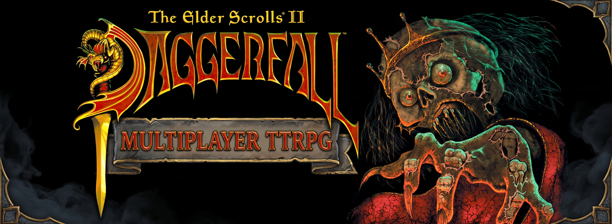

<p align="center">
  
</p>

# DFUM: Dungeon Master
### *Native Multiplayer & Tabletop RPG Virtual Engine for Daggerfall Unity*

[](https://unity.com/)
[](https://mirror-networking.gitbook.io/docs)
[](LICENSE)
[]()

**DFUM: Dungeon Master** transforms [Daggerfall Unity](https://www.dfworkshop.net/) into an immersive, collaborative **Tabletop RPG (TTRPG) Virtual Engine**. One player steps into the role of the **Dungeon Master (DM)** with real-time authoritative control over encounters, quests, weather, time, and world events, while adventurers explore the 15,000+ cities, dungeons, and landscapes of the Iliac Bay together in true cooperative multiplayer.

---

## 🌟 Key Features

### 🎲 1. Comprehensive Dungeon Master Toolkit (`Ctrl + F11`)
Take full narrative and environmental control in real time:
- **Live Monster Spawner Carousel:** Authoritatively spawn over 30+ enemy and humanoid types (Rats, Skeletons, Daedroths, Werewolves, Lichs, etc.) directly in front of you or across dungeon corridors.
- **Environmental Mastery:** Instant controls for world time (Dawn, Noon, Dusk, Midnight, custom hours) and dynamic weather overrides (Sunny, Overcast, Rain, Thunderstorm, Snow, Dense Fog).
- **Time Dilation (`timescale`):** Accelerate time up to 60x or pause the world for tactical planning.
- **Party Gather (`gather_party`):** Authoritatively gather separated players into your current dungeon, tavern, or wilderness coordinates with automated cell synchronization.
- **DM Invisibility (`dm_invis`):** Become invisible to monsters and remote clients, allowing unobtrusive oversight of party actions without triggering AI hostility or crime reporting.
- **God Mode (`dm_god`):** Toggle true invincibility with infinite vitals to freely inspect high-hazard areas.

### 🦅 2. Eagle Eye / FreeCam Flight (`Ctrl + F8`)
- Uncouple your camera into full 6-DOF flight across the world.
- Smooth mouse look (yaw & pitch) and WASD flight with sprint boost (`Shift`).
- Vertical flight controls (`Space` to ascend, `C` to descend).
- Mouse wheel dynamic speed scaling (from 2 m/s up to 150 m/s) with on-screen HUD feedback.
- **Physical DM Puppet:** Automatically renders a third-person avatar of the DM standing in the world marked `[YourName] (You)` (automatically concealed when DM Invisibility is active).

### 📜 3. Multiplayer Quest System & Creator (`Ctrl + F7`)
- **60-Second Opt-In Consensus Voting:** When a player or NPC offers a quest, the party receives a parchment prompt with a 60-second voting window. Only players who opt in accept the contract.
- **Deterministic Quest World Generation:** Quests synchronize target dungeon sites, NPC turn-ins, and time limits across all clients using unified deterministic seeds.
- **Synchronized Boss Battles & Foes:** Quest targets (e.g. giant scorpions, vampires, rogue warlords) replicate cell context (`isInside`, `buildingKey`, `dungeon`) and advance kill counters for the whole party upon defeat.
- **Quest Inspector & Instant Teleport:** Inspect active quests, target coordinates, and turn-in NPCs with one-click `TP to Objective` and `TP to Questor` debugging buttons.

### 💬 4. Acoustic Dialogue Synchronization
- **3D Overhead Speech Bubbles:** Conversations with NPCs and fellow adventurers render floating dialogue bubbles dynamically positioned over speakers' heads.
- **Distance Acoustic Falloff:** Text opacity scales naturally with hearing distance (crisp within 3.5m, fading beyond 8m, inaudible past 16m).
- **Sequential Line Replacement & Fadeout:** Eliminates chat spam by replacing lines sequentially and smoothly fading out upon conversation exit.

### ⚔️ 5. Authoritative Combat, Loot & Resting
- **Multi-Target AI Aggro:** Enemies intelligently target both host and client puppets based on proximity and threat.
- **Material Hit Immunity:** Authoritative metal weapon requirements (e.g., silver/mithril for Daedra, werewolves, and ghosts) are enforced server-side.
- **Synchronized Corpse Markers & Containers (`Ctrl + F12`):** Vanquished foes leave lootable corpses with full inventory replication. Multiple players can inspect and take items concurrently.
- **Synchronized Rest & Loitering:** Vote to rest together in wilderness or taverns with progressive blackout overlays and formula-accurate health/fatigue recovery.

---

## 🎮 Hotkeys & Shortcuts Reference

| Hotkey | Feature | Description |
| :---: | :--- | :--- |
| **`Ctrl + F7`** | **Quest Creator & Inspector** | Select quest presets, factions, fast-travel browser, and party offers. |
| **`Ctrl + F8`** | **Eagle Eye / FreeCam** | Toggle 6-DOF decoupled observer flight mode. |
| **`Ctrl + F10`** | **Multiplayer Network GUI** | Host server, join clients, view status, and toggle logging filters. |
| **`Ctrl + F11`** | **Dungeon Master Tool** | Spawns, teleportation, time, weather, DM invisibility, and god mode. |
| **`Ctrl + F12`** | **DM Loot Tool** | Authoritative container and corpse spawning for loot management. |
| **`~` / `` ` ``** | **In-Game Console** | Open console for CLI commands (`dm_tp`, `gather_party`, `net_quest`, etc.). |

*For complete command syntax and parameter details, see [Docs/CONSOLE_COMMANDS.md](Docs/CONSOLE_COMMANDS.md).*

---

## 🚀 Getting Started

### Prerequisites
1. **Unity Editor:** `2019.4.28f1` LTS (or any compatible `2019.4.x` release).
2. **Daggerfall Game Files:** Free official game data (e.g. from [Daggerfall Workshop](https://www.dfworkshop.net/)).

### Installation
1. Clone this repository:
   ```bash
   git clone https://github.com/BauerPablo/DFUM-DungeonMaster.git
   ```
2. Open the project folder in Unity Hub using **Unity 2019.4 LTS**.
3. Open the main game scene at `Assets/Scenes/DaggerfallUnityGame.unity`.
4. Press **Play** in the editor, or build a standalone executable via `File -> Build Settings`.

### Starting a Multiplayer Session
1. **Host (Dungeon Master):**
   - Press **`Ctrl + F10`** and click **Start Host (Port 7777)**, or enter in console:
     ```text
     net_host 7777
     ```
2. **Client (Adventurer):**
   - Press **`Ctrl + F10`**, enter the Host's IP address, and click **Connect as Client**, or enter in console:
     ```text
     net_join <host_ip> 7777
     ```

---

## 🏗️ Architecture & Technical Highlights

```
   ┌─────────────────────────────────────────────────────────┐
   │                   Daggerfall Unity Engine               │
   └────────────────────────────┬────────────────────────────┘
                                │
                 ┌──────────────┴──────────────┐
                 ▼                             ▼
       Authoritative Host              Remote Clients
     ┌─────────────────────┐       ┌─────────────────────┐
     │  DFUNetworkManager  │       │  DFUNetworkManager  │
     │  DFUNetworkRegistry │       │  DFUNetworkRegistry │
     │  Authoritative AI   │       │  Client Enemy Proxy │
     │  Authoritative Loot │       │  Client Puppet Sync │
     └──────────┬──────────┘       └──────────▲──────────┘
                │   Mirror Networking (KCP)   │
                └───────────────►─────────────┘
```

- **Native Authoritative Architecture:** Replaces fragile external mod injection with core native engine hooks, guaranteeing determinism, cheat protection, and zero desync.
- **Elevation Raycasting Safeguard:** Teleports utilize high-altitude (1500m) terrain raycasting, seating players safely at ground level + 1m and zeroing fall damage in `AcrobatMotor` during chunk generation.
- **Cell Context Awareness:** Remote proxies and player avatars dynamically switch visibility and parenting between Exterior, Interior Buildings (`buildingKey`), and Dungeons.

---

## 🗺️ Roadmap & Upcoming Milestones

- [ ] **Interactive P2P Map Sharing:** Right-click party members to share discovered town and dungeon map fog-of-war.
- [ ] **Multiplayer Save / Load Consensus:** Synchronized party save games and load voting.
- [ ] **Custom TTRPG Dice Rolling & DM Announcements:** Visual 3D dice rolls in chat and full-screen DM banners.
- [ ] **Spectator & Downed State:** Tabletop death-saving throws and revives for party members.

---

## 📄 Documentation

- [Console & DM Command Reference](Docs/CONSOLE_COMMANDS.md)
- [Phase 10 Manual Testing Guide & Checklist](Docs/testing_docs/manual-testing-phase-10-quest-creator.md)
- [Native Multiplayer PRD & Architecture Spec](Docs/PRD_NATIVE_MULTIPLAYER.md)
- [AI Multi-Target Targeting Logic](Docs/AI_TARGETING_LOGIC.md)

---

## 🤝 Credits & Acknowledgements

- **[Daggerfall Workshop](https://github.com/Interkarma/daggerfall-unity)** by Gavin "Interkarma" Clayton and the DFU community.
- **[Mirror Networking](https://github.com/MirrorNetworking/Mirror)** for high-performance open-source UDP transport.
- **Bethesda Softworks** for creating *The Elder Scrolls II: Daggerfall*.

---

<p align="center">
  <b>Built with passion for tabletop adventurers and Daggerfall enthusiasts worldwide.</b>
</p>
